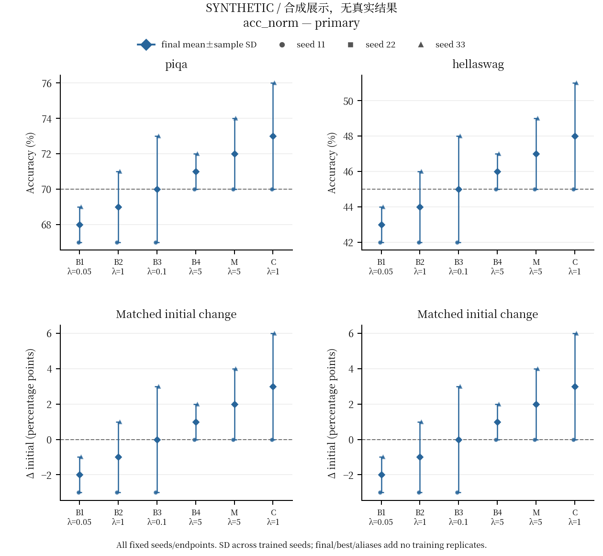
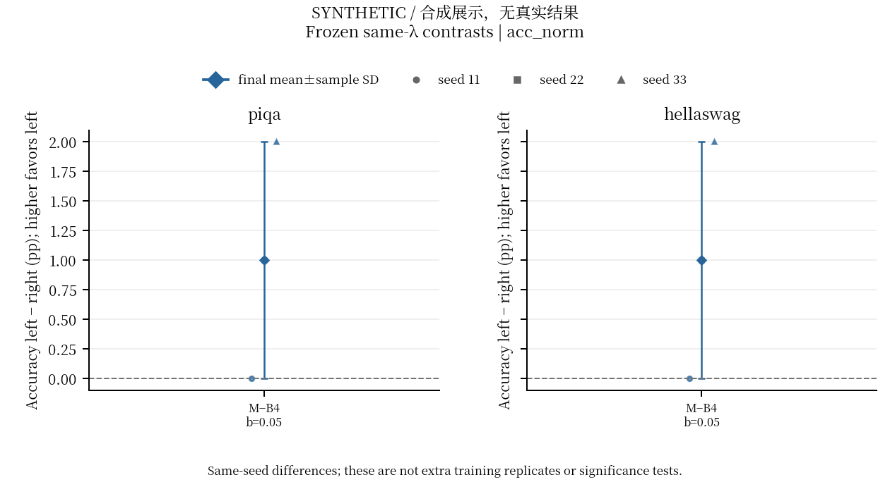
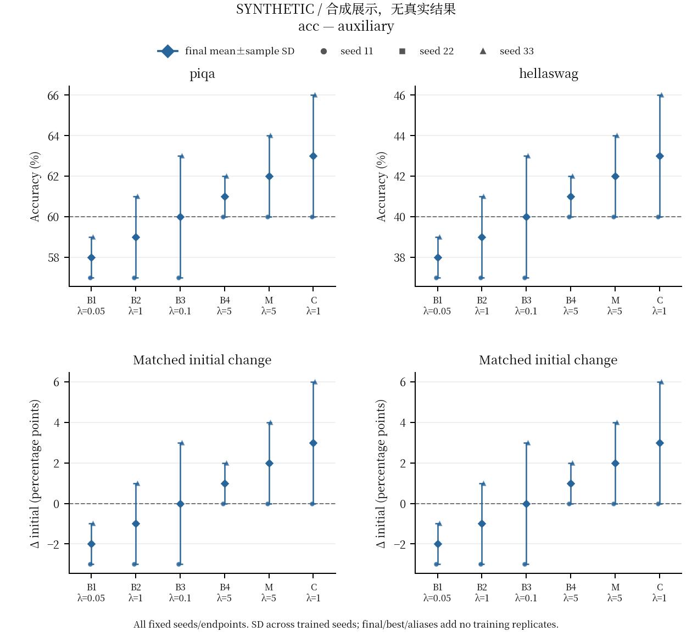
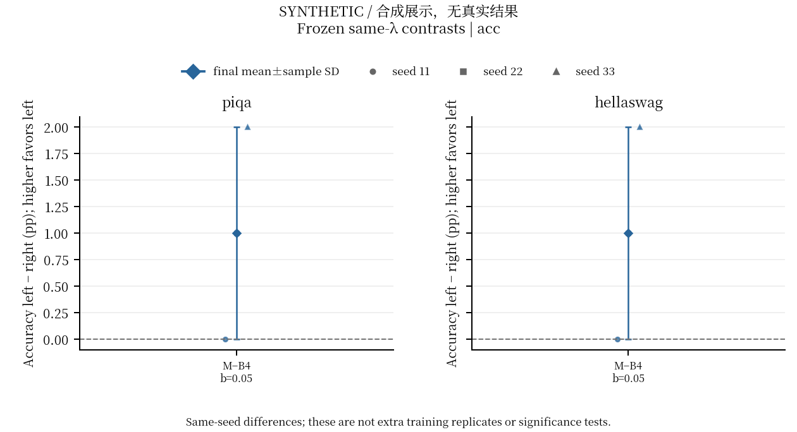
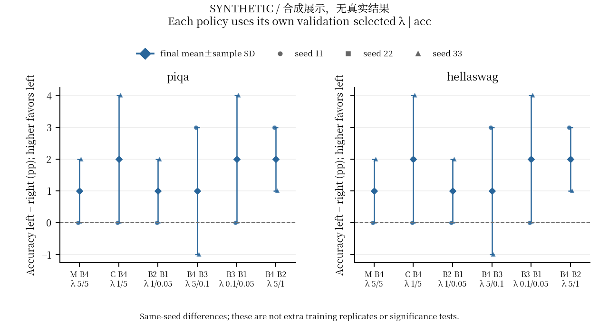

SYNTHETIC: all displayed values are hand-made examples, not actual task results.

# Behavior presentation: supplement_A

All 18 logical endpoints, both tasks and both scores are retained. acc_norm is primary; acc is auxiliary.

Figures show all three trained seed points and existing mean±sample SD. Same-λ pairs and each-method validation-selected-λ policy pairs are separate. No new CI, score, selection or inference is computed.

All individual identities, actual best/final step and target/replay exposure, transitions and conditional Wilson/bootstrap outputs remain in the copied full-precision CSVs. Best exposure differs from full training cost; aliases/final/best/questions do not increase the training-seed count. Physical training cost must use the original actual_run_id/full_training_committed_path, not plotted exposure.

Question intervals are conditional on fixed checkpoints and IID/exchangeable questions. Shared activities/contexts may be correlated; they are not training-repeat or automatic population CIs.

A policy figures use selected_policy_score_resolved_statistics.csv (separate score/quantity). The original label-collision aggregate is never read. Each method has its own frozen validation λ; this does not isolate a fixed-λ objective effect.

