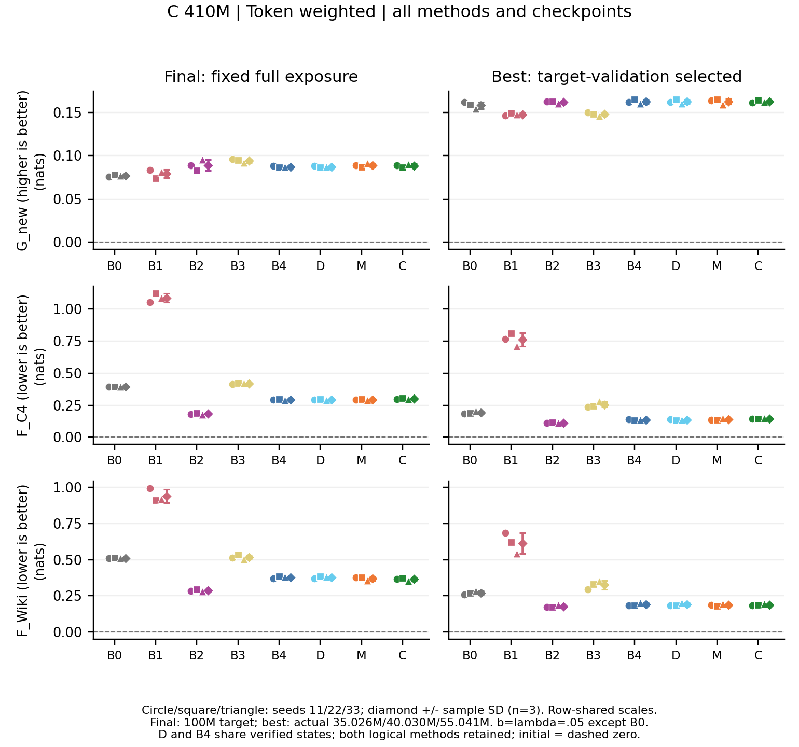

# C410主报告插入候选（ROOT整合，非直接改报告）

本组使用扩展匹配数据和initial，全部8方法×3seed的final/best共同完整解封。final统一100M目标tokens；B0不回放，其余b=λ=.05并累计5M回放。下表为三seed均值±sample SD，G越大、F越小越好，单位nats；D/B4经双方checkpoint SHA绑定的完整state证明相同，仍分别保留逻辑标签和实际训练费。

| 方法 | G_new ↑ | F_C4 ↓ | F_Wiki ↓ |
| --- | --- | --- | --- |
| B0 | 0.076896 ± 0.001038 | 0.393509 ± 0.000692 | 0.510911 ± 0.002205 |
| B1 | 0.079258 ± 0.004918 | 1.087379 ± 0.034758 | 0.940220 ± 0.045933 |
| B2 | 0.089011 ± 0.006282 | 0.181319 ± 0.005562 | 0.286114 ± 0.007847 |
| B3 | 0.093875 ± 0.002161 | 0.419255 ± 0.003314 | 0.516845 ± 0.014993 |
| B4 | 0.087032 ± 0.000841 | 0.291661 ± 0.003597 | 0.377083 ± 0.007814 |
| D | 0.087032 ± 0.000841 | 0.291661 ± 0.003597 | 0.377083 ± 0.007814 |
| M | 0.088891 ± 0.002212 | 0.292453 ± 0.003803 | 0.369363 ± 0.013429 |
| C | 0.088314 ± 0.002036 | 0.299878 ± 0.005373 | 0.364531 ± 0.011263 |

KL相对CE在两种回放来源中都减少旧域遗忘，但目标增益随端点改变。C4来源B2−B1的final ΔG=+0.009754±0.004606、ΔF_C4=−0.906060±0.031266、ΔF_Wiki=−0.654106±0.049217；best三项方向也均为3/3 seed有利。生成来源B4−B3的final ΔG=−0.006843±0.002144（0/3有利），best变为+0.014413±0.002290（3/3有利）；两端点旧域差均为负且各3/3有利。因此不能把validation选best的目标优势当成固定100M final的结论。

M/C仍未形成跨域、跨端点的一致优势。final的M−B4为ΔG=+0.001859±0.001958、ΔF_C4=+0.000793±0.000220、ΔF_Wiki=−0.007720±0.018371，有利seed数3/0/2；best则为+0.000236±0.001431、+0.004266±0.006515、−0.002412±0.006332，有利数1/1/2。C−B4的final为+0.001282±0.001484、+0.008217±0.001887、−0.012552±0.014334；best为+0.000102±0.001481、+0.008096±0.002828、−0.000809±0.005157。旧域间及seed间的取舍仍存在，不能由均值排名推出更普遍的保留能力。等文档口径下final M−B4的目标有利数由3/3降至2/3，进一步说明长度权重会改变小差异的个体方向。

22个best位于40,029,696目标tokens；B1 seed33为35,025,984，B3 seed33为55,040,832，非B0对应回放分别为2,001,484／1,751,299／2,752,041。best不是相同预算对照，也不减少已经完成的100M训练成本。全部24个best相对各自final在六指标方向均有利，仅描述冻结validation选点政策，未按测试另选时长。逐seed及条件文档区间不能替代n=3训练随机性描述：例如final M−B4的Wiki差三个seed一正两负，虽然各自文档区间不跨0；区间只条件于固定checkpoint与可交换文档假设。

按actual-run去重，24次完整训练committed父项50,214.167753s（setup95.463617、training40,875.164597、validation8,828.295548、checkpoint415.243991）；43次实际forward（42适应＋1初始）whole-slot合计3109.684094s，6别名新增0forward。内含scorer1121.408774s、核验1665.495799s、teacher186.670214s不能再次相加，whole-slot也不是纯GPU时间或独占calendar elapsed。CPU分析整child11.763359s，后续独立核验/四图整child9.171234s，分别发生、不包含在推理slot。

本组是相关稳健性扩展：20,000,540目标训练预测位置包含主训练全部4096 chunks，100M约重复五遍；C4候选扩大且包含主候选，生成池沿用主来源。matched目标test979 chunks中959个与主v3共享，C4的979个全共享、Wiki529个完全相同。主microbatch16×4与本组64×1不同，peak LR虽同为3e−5，306→3058步使warmup/cosine曝光路径改变。因此不能当纯horizon因果效应或独立复现，不能将两阶段三seed合成六次独立重复。

完整best表、token／等文档六配对、48个体、504条条件区间、实际曝光与费用见[完整素材](C410_100M_NLL完整结果与正文素材.md)及[独立收据](../results/C410_nll_independent_review_v1/independent_review_receipt.json)。本文不涉及1B／2.8B或行为结果。
