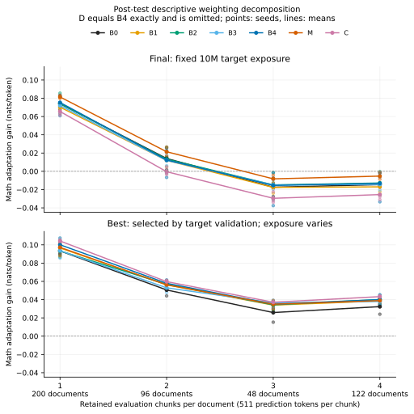

# 主数学测试的权重差异：测试后描述性分解

本分析在主 NLL 于 2026-11-06 07:14:59 UTC 解封后提出，属于 **post-test descriptive decomposition**。按 token 与按文档等权的两个指标本身已预先登记；这里新增的是解释二者为何不同的代数分解和分组展示。它没有新增模型推理、训练、调参或测试题目筛选，不能被改写成测试前假设。

分析包含全部 36 个主配置的 final/best 两端点、每端点相同的 466 篇 FineMath 测试文档，共 72 个逻辑端点。D/B4 仍如实保留在数据表中；图仅在逐 seed、逐端点、逐组确认数值完全相同后省略 D。其余独立测试或行为分数没有进入本分析。

## 两个估计对象与恒等式

设文档 d 保留的有效预测位置数为 n_d，文档目标增益为 g_d（初始 NLL 减适应后 NLL）。文档等权平均为所有 g_d 的算术平均；token 加权平均为 sum(n_d × g_d) / sum(n_d)。对这份固定文档集合有精确恒等式：

`G_token - G_doc = Cov_population(n_d, g_d) / mean(n_d)`。

这里协方差的分母为文档数 D，不是 D−1。它是加权平均的代数关系，不是关于长度如何影响训练的因果模型。本次 72 个端点的恒等式残差最大约 1.1×10⁻¹⁷；同时逐端点核对了冻结主分析中的两种原始增益，误差不超过 10⁻¹²。

每个完整输入块均为 512 token，计 511 个预测位置。每篇最多保留四块；长文档取块的规则早于测试分数冻结。以下“1—4 块”指**被保留的评价量**，并不是完整原文长度，也不是模型的上下文窗口长度。

| 每篇保留块数 | 文档数 | 文档等权占比 | token 加权占比 |
|---:|---:|---:|---:|
| 1 | 200 | 42.92% | 19.53% |
| 2 | 96 | 20.60% | 18.75% |
| 3 | 48 | 10.30% | 14.06% |
| 4 | 122 | 26.18% | 47.66% |

## 观测结果

主 b=.05 对照（B0 为0）在 final 的 token 增益减文档等权增益，组均值均在 −0.0207 至 −0.0219 nats/预测 token 左右。对于接近零的绝对增益，这足以改变正负号。例如 C 的 token 增益为 −0.00357，而文档等权为 +0.01832；这不意味着 C 相对随机组的排序被整体翻转，具体配对仍须看主结果表。

以下用预定随机 KL 对照 B4 展示分组均值；每个单元先在同一文档组内算增益，再对三个 pipeline seed 平均。不是把文档数作为训练重复数。

| B4 端点 | 保留1块 | 保留2块 | 保留3块 | 保留4块 |
|---|---:|---:|---:|---:|
| final，固定10M | +0.07536 | +0.01238 | −0.01543 | −0.01312 |
| best，验证选择 | +0.10009 | +0.05787 | +0.03506 | +0.04002 |

final 中保留3/4块的文档组平均增益较低，它们在 token 加权中得到更大权重，所以 token 加权结果更低。best 的组均值也随这些组而异，但四组平均增益均为正。完整图展示全部七个不同主方法，全部预算条件、逐 seed、逐文档数值均随 CSV 提供；不按结果删去不利条件。

文档组可能同时在主题、来源、原文长度和取块位置等方面不同。所有模型看到的块长都相同；这张图不能证明更长上下文更难学习，也不能识别是哪种数据属性造成差异。图中两端点来自同一次训练，best 由验证集选择且曝光可能不同；不是独立复制，也不是同训练量的停止策略试验。两个预先登记的权重各自回答不同问题，应并列报告，不能根据正负号临时挑一种。

## 复算与来源

[脚本](../scripts/describe_primary_target_weighting.py)只复用已经授权解封的主测试结果，并复核完整主分析、结果与来源 SHA。脚本输出 [端点分解](../results/analysis/primary_target_weighting_posttest/endpoint_decomposition.csv)、[文档组统计](../results/analysis/primary_target_weighting_posttest/retained_chunk_groups.csv)、全部逐文档增益以及 PNG/PDF/SVG 图。精确声明时间见[分析协议](primary_target_weighting_decomposition_protocol.json)，完整来源与输出哈希见[manifest](../results/analysis/primary_target_weighting_posttest/manifest.json)。

CSV 的组内 document SD 只是文档间描述性离散，不是模型效应的置信区间。主结果预先规定的成对文档 bootstrap 与三个 pipeline seed 的样本 SD 仍分别报告，本分解不增加训练重复数或独立数据集。
