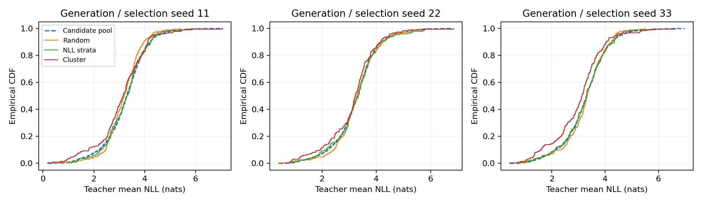

# 固定生成池与回放库的分布诊断

这些指标在正式测试损失与行为任务得分查看之前，从已经冻结的三个生成池和选库产物计算。它们只描述选择改变了什么，不用于重新挑选方法或样本。

| 选择 | NLL经验CDF最大差均值 ± SD | 归一教师特征最近代表平方距离均值 ± SD | 库中教师NLL均值 ± SD |
|---|---:|---:|---:|
| 随机 | 0.0635 ± 0.0277 | 0.2413 ± 0.0035 | 3.2432 ± 0.0632 |
| NLL比例分层 | 0.0322 ± 0.0051 | 0.2387 ± 0.0067 | 3.2585 ± 0.0086 |
| 聚类代表 | 0.1068 ± 0.0218 | 0.2096 ± 0.0030 | 3.0850 ± 0.0540 |

表中SD为三个生成/选库seed之间的描述性样本标准差，不是训练性能的不确定性。每个pool有1957块，每个bank有196块，均为512输入token/511预测token。去重随机组与随机组indices完全一致，相关诊断数值也相同。

NLL比例分层更贴近候选池的NLL经验分布，这与它固定五个等频层比例的机制一致。聚类代表降低了当前教师特征空间中的平均最近代表距离，但其库中NLL均值更低，NLL经验分布与原池的偏移更大。一个方法在自己的选择空间中更有代表性，并不能推出它在C4、WikiText或行为能力上保留得更好。

特征为冻结教师最后层有效预测上下文的均值，再做L2归一；距离采用最近bank向量的欧氏平方距离。它不是语义覆盖率，也不是待评估文本分布的覆盖率。CDF最大差与Wasserstein-1仅作描述，不报告独立样本检验p值。

[完整CSV](../results/bank_diagnostics/bank_geometry.csv)；[含输入SHA256的JSON](../results/bank_diagnostics/bank_geometry.json)；[复现脚本](../scripts/analyze_bank_geometry.py)。
