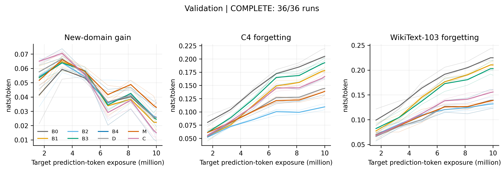

# 固定回放预算下的语言模型领域适应 遗忘与保留的实证研究

**研究工作稿，实验进行中。最终摘要与结论将在预定测试完成后填写。**

研究时段为 2026 年 11 月 6 日 03:26:32 至 11 月 7 日 03:26:32 UTC。工作以原始[开题报告](开题报告.pdf)为依据，在 4 张 NVIDIA H100 80GB 上开展。本文区分原计划主实验、预先声明的补充实验，以及用于发现工程问题的诊断运行。配置或代码已完成，不等于对应实验已完成。

## 1. 研究定位

研究对象是在英文数学文本上继续进行下一词预测训练的语言模型。目标是测量适应增益与通用文本性能变化，并检验在有限回放库、固定累计回放量下，来源、训练目标和样本选择各起什么作用。数学文本损失下降不是数学推理能力的直接证据；通用语料的损失变化也不能代表全部预训练知识。

本文不把自生成回放、教师蒸馏或聚类选择作为新算法发明。预期贡献是可复核的因素比较：分开控制回放库容量、累计暴露和损失权重，报告选择是否有效、何时无效，以及数据生成和教师推断的成本。相关文献的证据、发表状态与适用边界见[文献调研](literature/文献调研.md)和[参考文献数据库](literature/references.bib)。

## 2. 文献形成的研究路线

已有研究表明，通用数据回放可能减轻遗忘，也可能改善目标域学习；小比例注入在特定设置中有效，并不意味着存在跨模型通用的最优比例。固定有限库被重复利用时，还需要区分新样本覆盖和重复训练。自生成回放为无法取得原始预训练数据时提供了可检验的替代方案，但其覆盖范围和优化行为仍需独立评价。[Béthune 等，ICML 2025](https://proceedings.mlr.press/v267/bethune25a.html)、[Marek 等，2026](https://arxiv.org/html/2605.26097v1)、[Kotha 与 Liang，2026](https://arxiv.org/html/2603.04964v1)。

选择策略的依据需要与评价指标相区分。NLL 分层约束有限库中的惊讶程度分布，聚类约束教师表示空间中的代表性；二者都不能直接推出保留效果。SSR 已包含聚类选择等步骤，因此本文的聚类组是受既有工作启发的控制，并非完整 SSR 复现。[Huang 等，ACL 2024](https://aclanthology.org/2024.acl-long.77/)。

据此，研究问题分为三类：相同回放预算下的来源与目标比较；同一生成池上的选库比较；收益对暴露、库容量和准备成本的敏感性。主实验回答第一层控制问题，补充实验检验结论对参数和数据规模的依赖。

## 3. 主实验设计

主模型为最终预训练检查点 Pythia-410M，完整更新所有学生参数，初始模型同时作为固定教师。目标语料为 FineMath 的 finemath-4plus，替代通用回放为 C4 English；分别在数学文本、独立 C4 和 WikiText-103 上评价。C4 不是 Pythia 实际使用的 Pile 预训练语料，因此这里只称替代通用回放。

| 组别 | 回放来源与选择 | 回放目标 |
|---|---|---|
| B0 | 无回放 | 仅目标域 CE |
| B1 | C4 随机库 | CE |
| B2 | 与 B1 相同的 C4 库 | 冻结教师到学生的 forward KL |
| B3 | 自生成随机库 | CE |
| B4 | 与 B3 相同的生成库 | forward KL |
| D | 生成池精确去重后随机选择 | forward KL |
| M | 去重后按教师 NLL 五等频层比例抽样 | forward KL |
| C | 去重后按冻结教师表示聚类选代表 | forward KL |

主训练集包含 2,093,056 个不同预测位置，固定累计处理 10,000,000 个目标预测 token。每个生成池为 1,000,027 个预测 token，每个主回放库为 100,156 个预测 token。512 个输入 token 的完整块对应 511 个因果预测位置，边界余量通过 mask 精确计数。八组各使用三个种子；B4/M 另加两个暴露比例，共 36 个主配置。

累计回放比定义为 `b = replay_prediction_tokens / target_prediction_tokens`，主值为 0.05，敏感性值为 0.01 和 0.10。目标与回放损失分别按各自有效预测位置取均值，再以独立权重 λ 相加；因此固定 λ 改变 b 并不等于让回放平均损失权重按 b 成比例变化。完整公式、生成 CE 与 KL 的关系、分层方差的适用假设见[方法推导与解释边界](docs/方法推导与解释边界.md)。

### 3.1 参数选择与公平比较

学习率由独立校准种子 101 的目标验证损失选择，候选为 10⁻⁵、3×10⁻⁵、10⁻⁴；最终采用 3×10⁻⁵。共享 λ 候选为 0.05、0.5、1、5，按 B1—B4 的平均验证得分选择：目标 NLL 变化加两个旧域 NLL 变化的平均值，得分越低越好，最终采用 0.05。这里的等权得分是一项明确的决策规则，不是所有应用共同接受的效用函数。各方法共享这一选择，保证校准规则一致，但不保证各自达到最优；补充 A 再提供较完整的权重曲线。

每步有效目标批量为 64 个完整块，采用 microbatch 16、梯度累积 4；末步按剩余有效预测位置计数。优化器为 fused AdamW，β=(0.9,0.95)、ε=10⁻⁸、weight decay=0.1、梯度范数裁剪阈值 1。学习率采用 3% warmup 和余弦衰减，最低为峰值的 10%。学生与教师权重保留 FP32，CUDA 前向采用 BF16 autocast，CE/KL 概率运算使用 FP32。KL 覆盖完整词表，不只比较生成 token 的概率。

同一 seed 下，各组共享目标文本顺序与学习率日程；回放具有独立的数据流和计数。306 步完成 10M 目标预测 token，主回放比例对应累计 500,000 个预测 token，约为 100,156-token 回放库容量的五倍。这是反复读取有限库，不能称为新增了 500,000 个不同 token。优化、验证和数据生成均有单独日志，等 token 暴露也不等于等墙钟时间或等 FLOPs。

### 3.2 生成、选库与可检验机制

生成从单个 BOS token 开始，温度为 1，top-p=1、top-k=0；每块继续采样 511 个 token，遇到 EOS 仍继续，得到固定长度的 512-token 块。各正式 seed 有独立生成池，同一 seed 的 B3/B4/D/M/C 共用该池。未施加质量过滤或人工挑选；这种无条件生成方式便于控制预算，也限制了语义和任务覆盖。

M 根据教师平均 NLL 排序分为五个等频层，按最大余数法分配抽样整数配额。它控制的是所选库的 NLL 组成，不直接优先容易文本。C 对教师最后层预测上下文的平均表示作 L2 归一化，使用 MiniBatchKMeans 并选最近代表。选择统计与评估任务不同，特征覆盖改善不能当作旧知识保留的证据。实际生成池没有整块精确重复，因此 D 与 B4 的库完全相同；本次 D 是数值空对照，不能估计在有重复语料中的去重收益。

对固定上下文，若硬标签确由同一教师完整分布采样，生成 CE 的期望等于 forward KL 加上与学生参数无关的教师熵。这不意味着当前有限库中两种训练相同：初始学生等于教师时，KL 梯度为零，而固定生成标签的 CE 梯度通常不为零；重复回放不会自动消除那次标签抽样的误差。真实 C4 的条件分布也不等于教师分布，B2−B1 不能只解释为标签采样降噪。

## 4. 数据与数值有效性

FineMath 先按规范化文档哈希划分，再逐文档分块；C4 回放与评价分开，WikiText 按文章重建。精确重复及固定阈值的 token ngram 检查均有机器记录。数据抽样限于若干固定 shard 的顺序前部，并排除不能形成完整块的短文本，因此结论条件于这些采样与长度规则。

初期数据审查发现旧数学验证集受一篇长文档支配。正式评价前据此建立独立路径 `evaluation_v3`：FineMath/C4 各验证与测试集合扩为 1024 块，每篇最多四块，长文档按固定文档哈希均匀取块。该修改由数据集中度触发，没有使用测试损失；旧版校准结果保留为历史记录。

| 主实验数据角色 | 块数 | 有效预测 token 数 | 约束 |
|---|---:|---:|---|
| FineMath 训练 | 4,096 | 2,093,056 | 文档划分后分块 |
| C4 候选回放 | 2,048 | 1,046,528 | 与独立 C4 评价分开 |
| FineMath 验证 / 测试 | 各 1,024 | 各 523,264 | 每篇最多四块 |
| C4 验证 / 测试 | 各 1,024 | 各 523,264 | 每篇最多四块 |
| WikiText-103 验证 | 461 | 235,571 | 官方分区，按文章重建 |
| WikiText-103 测试 | 529 | 270,319 | 官方分区，按文章重建 |

主 FineMath 验证/测试分别包含 507/466 篇文档，C4 为 625/595 篇。块级平均仍使较长文档有较大权重，因此最终测试同时补报等文档加权结果和成对文档 bootstrap。去污染在完整文档层面执行，再施加每篇块数上限；精确重复和 13-gram 覆盖率检查不能保证语义独立，也不能排除这些公开文本曾出现在模型预训练中。

相同生成库的 B4/D 空对照进一步发现，默认 CUDA 注意力反向传播的非确定性足以影响训练比较。原批次已隔离，不进入正式方法结论。严格确定性设置通过跨 GPU 梯度和权重重复检查后，全部学习率和 λ 校准重新执行。完整 306 步 B4/D 资格检查中，各步损失、梯度范数、七次验证以及最终权重均一致。正式代码版本为 `de54262b8deff2c49547bba740d0dbf28a1074a7`，十个核心源码与训练前快照相符。

这次修复不意味着任意硬件和软件版本之间都能逐位复现。最终 36 组训练全部完成，[完整审计](results/formal_run_audit.json)没有发现违反冻结协议的情况；三个 seed 的 B4/D 逐步训练、验证值及完整模型参数指纹均相同。这证明当前平台及冻结实现下的相同输入控制通过了实际检查。记录另见[确定性证据](results/determinism_evidence.json)、[最初资格检查](results/formal_deterministic_qualification.json)和[独立实现审查](docs/独立实现审查.md)。

## 5. 结果章节与统计约定

**主实验训练与验证分析已完成；独立测试结果仍待预定评估。**

固定目标暴露的最终检查点为主要端点；按目标验证损失选择的最佳检查点另报，并保留其实际训练量。C4 与 WikiText 的变化分别报告。三个训练种子的个体结果、均值与样本标准差同时给出；成对文档 bootstrap 只描述给定检查点下的文档抽样不确定性，不代替训练种子的变化。

选库机制的前置诊断见[回放库分布诊断](docs/回放库分布诊断.md)。成本测量区分方法独立使用时所需统计与本研究共享准备产物的实际消耗。训练、验证、检查点写入和准备过程分别计时，教师前向等嵌套计时不重复相加。

### 5.1 完整验证结果：用于诊断，尚非独立测试结论

以下是已完成主36的验证端点，其中主比例对照为八组各三个 seed。表中数字为均值 ± 样本标准差，单位为 nats/预测 token；初始验证 NLL 为数学 2.420674、C4 3.068728、WikiText 3.129984。G 为初始减适应后数学 NLL，F 为适应后减初始旧域 NLL。全部最终端点的目标暴露均为 10M。

| 组别 | 目标增益 G（越大越好） | C4 遗忘 F（越小越好） | WikiText 遗忘 F（越小越好） |
|---|---:|---:|---:|
| B0 | 0.0259 ± 0.0093 | 0.2050 ± 0.0134 | 0.2250 ± 0.0156 |
| B1 | 0.0223 ± 0.0049 | 0.1781 ± 0.0051 | 0.2106 ± 0.0070 |
| B2 | 0.0260 ± 0.0123 | 0.1096 ± 0.0052 | 0.1321 ± 0.0109 |
| B3 | 0.0245 ± 0.0063 | 0.1929 ± 0.0119 | 0.2030 ± 0.0154 |
| B4 | 0.0258 ± 0.0144 | 0.1444 ± 0.0161 | 0.1396 ± 0.0191 |
| D | 0.0258 ± 0.0144 | 0.1444 ± 0.0161 | 0.1396 ± 0.0191 |
| M | 0.0328 ± 0.0035 | 0.1389 ± 0.0058 | 0.1391 ± 0.0004 |
| C | 0.0150 ± 0.0068 | 0.1670 ± 0.0068 | 0.1560 ± 0.0071 |

同来源的 KL−CE 对比在三个 seed 上均减少旧域损失增长：B2−B1 在 C4/WikiText 的成对差为 −0.0685±0.0011 / −0.0786±0.0042；B4−B3 为 −0.0485±0.0144 / −0.0634±0.0114。相应目标增益差较小且 seed 方向混合。生成 KL 相比 C4 KL 的目标增益几乎相同，但 C4 遗忘更高；本结果不支持生成回放全面优于替代真实文本。

M−B4 在目标增益和两个旧域上的平均差分别为 +0.0070、−0.0056、−0.0006，均小于对应成对标准差，主要受 seed22 影响；另两个 seed 的旧域结果反而较差。因此三 seed 的均值不足以证明分层稳定改善保留。C 在所定义表示空间中的覆盖更好，但验证目标增益和旧域保留的平均结果都比 B4 差。这是机制诊断与实际保留之间不能直接划等号的一个实例，不是所有聚类选择方法都无效的结论。

36 个按目标验证选择的最佳检查点全部早于最终 10M：1 个位于 1.6352M、33 个位于 3.2704M、2 个位于 4.9056M。最佳验证点的数学收益组均值约为 0.060—0.071，而最终组均值约为 0.015—0.033，提示有限目标库重复训练后出现验证退化。最佳点使用同一验证集选择，其指标有选择偏差，并且曝光不同；必须通过独立测试另报，不能替换等 10M 的主要比较。

相近目标损失的插值仅是粗粒度诊断，大部分穿越位于初始模型到首个验证点之间。由于没有对应真实中间检查点，不用它断言同等适应程度下的精确优势。完整数值、全部预定配对与实际曝光见[验证分析](results/analysis/formal_deterministic_validation/figure_notes_zh.md)和[最佳验证端点](results/analysis/formal_deterministic_validation_best/best验证端点说明.md)。

### 5.2 独立测试与行为结果

正式测试与行为推理尚未开始。本节将在预定方法、参数和端点冻结后，以实际测试输出填写。

## 6. 补充实验与解释边界

[补充实验预案](docs/补充实验预案.md)包含损失权重曲线、固定训练流与生成池的选库条件波动、较大目标库与较大模型，以及固定的零样本选择题评价。补充 B 的抽样种子不是独立训练种子。扩展训练与主数据有包含和重合关系，需要使用配套去污染评价集合，也不能称为第二次独立总体复制。

共享小规模校准提供统一、可审计的比较条件，不保证每个方法在长训练下达到全局最优。局部表示覆盖、输出 KL、文本 NLL 和选择题正确率描述不同对象。最终结论将依据实际完成的实验范围，明确未验证的模型、分布与能力。

## 7. 复现与交付状态

代码位于 `src/replay_study/` 和 `scripts/`，冻结配置、输入版本与哈希位于 `configs/` 和 `artifacts/`。实际运行状态见[STATUS](docs/STATUS.md)。共享存储出现 ENOSPC 后，工作树迁至本机大盘，原路径通过链接保留；最终交付时将单独列明持久化归档与仍在临时盘上的大型权重，避免将两者混淆。

本文与配套代码由 AI 协助研究和实现，保留来源、实验日志和失败记录，供作者复核、修改并按学校要求披露。当前文档为研究交付工作稿，不能把占位内容视为已经得到的实验发现。
