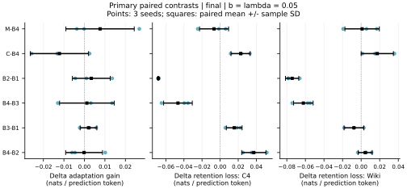
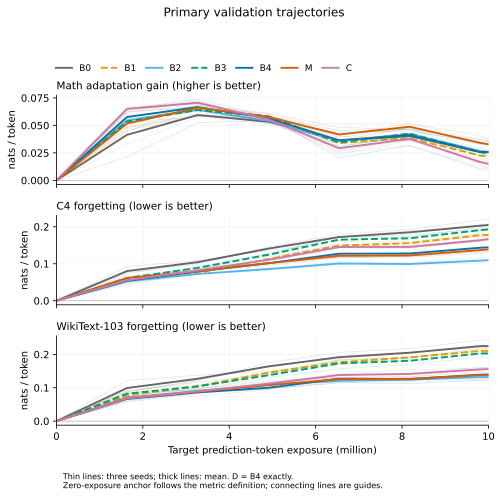
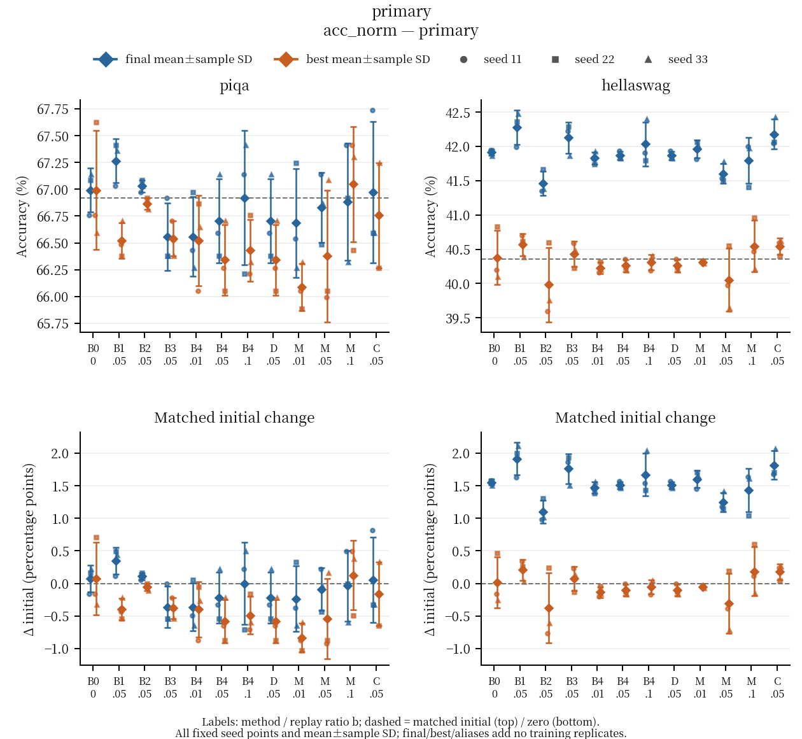
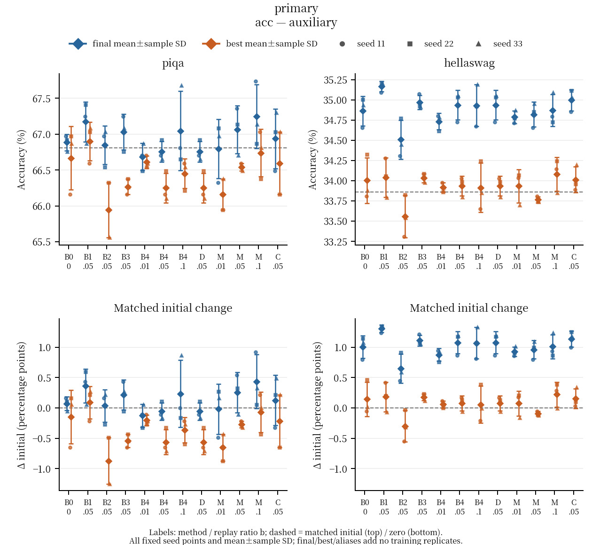
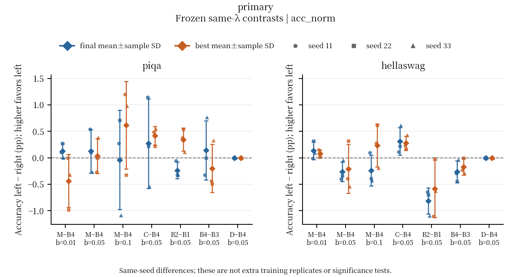
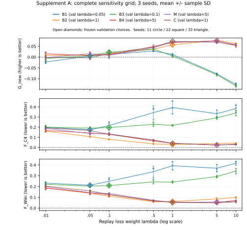
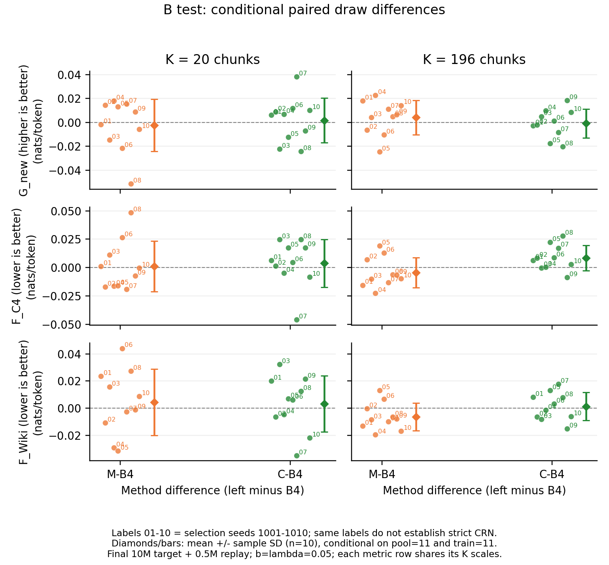
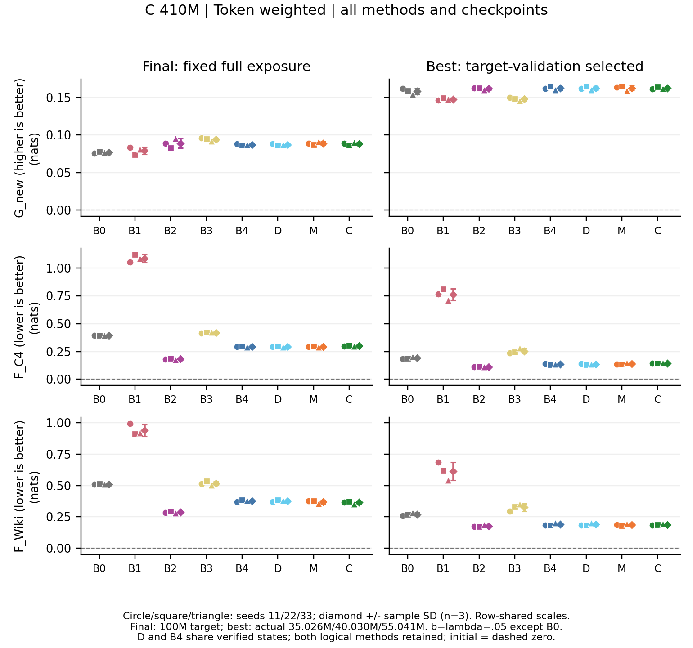
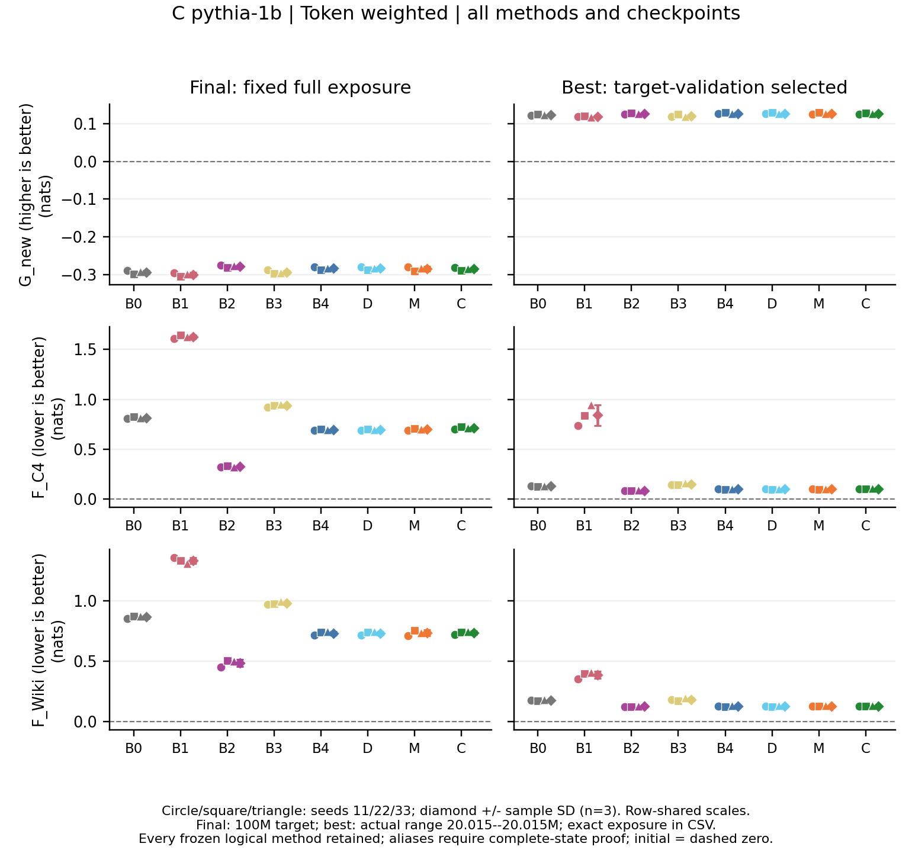
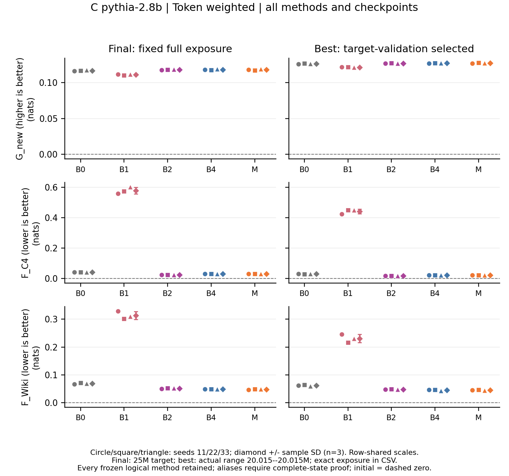

# 固定回放预算下的语言模型领域适应 遗忘与保留的实证研究

**研究工作稿。预定的267项正式训练与514项冻结独立评价（主实验、补充A/B、410M/1B/2.8B长程及其行为评价）已全部完成；结果均在各自完整闭包与授权门禁后解封、完成独立复核并写入本文。最终摘要、结论与学校格式定稿仍须作者本人核验。**

研究时段为 2026 年 11 月 6 日 03:26:32 至 11 月 7 日 03:26:32 UTC。工作以原始[开题报告](开题报告.pdf)为依据，在 4 张 NVIDIA H100 80GB 上开展。本文区分原计划主实验、预先声明的补充实验，以及用于发现工程问题的诊断运行。配置或代码已完成，不等于对应实验已完成。

## 1. 研究定位

研究对象是在英文数学文本上继续进行下一词预测训练的语言模型。目标是测量适应增益与通用文本性能变化，并检验在有限回放库、固定累计回放量下，来源、训练目标和样本选择各起什么作用。数学文本损失下降不是数学推理能力的直接证据；通用语料的损失变化也不能代表全部预训练知识。

本文不把自生成回放、教师蒸馏或聚类选择作为新算法发明。预期贡献是可复核的因素比较：分开控制回放库容量、累计暴露和损失权重，报告选择是否有效、何时无效，以及数据生成和教师推断的成本。相关文献的证据、发表状态与适用边界见[文献调研](literature/文献调研.md)和[参考文献数据库](literature/references.bib)。

## 2. 文献形成的研究路线

已有研究表明，通用数据回放可能减轻遗忘，也可能改善目标域学习；小比例注入在特定设置中有效，并不意味着存在跨模型通用的最优比例。固定有限库被重复利用时，还需要区分新样本覆盖和重复训练。自生成回放为无法取得原始预训练数据时提供了可检验的替代方案，但其覆盖范围和优化行为仍需独立评价。[Béthune 等，ICML 2025](https://proceedings.mlr.press/v267/bethune25a.html)、[Marek 等，2026](https://arxiv.org/html/2605.26097v1)、[Kotha 与 Liang，2026](https://arxiv.org/html/2603.04964v1)。

选择策略的依据需要与评价指标相区分。NLL 分层约束有限库中的惊讶程度分布，聚类约束教师表示空间中的代表性；二者都不能直接推出保留效果。SSR 已包含聚类选择等步骤，因此本文的聚类组是受既有工作启发的控制，并非完整 SSR 复现。[Huang 等，ACL 2024](https://aclanthology.org/2024.acl-long.77/)。

据此，研究问题分为三类：相同回放预算下的来源与目标比较；同一生成池上的选库比较；收益对暴露、库容量和准备成本的敏感性。主实验回答第一层控制问题，补充实验检验结论对参数和数据规模的依赖。

## 3. 主实验设计

主模型为最终预训练检查点 Pythia-410M，完整更新所有学生参数，初始模型同时作为固定教师。目标语料为 FineMath 的 finemath-4plus，替代通用回放为 C4 English；分别在数学文本、独立 C4 和 WikiText-103 上评价。C4 不是 Pythia 实际使用的 Pile 预训练语料，因此这里只称替代通用回放。

| 组别 | 回放来源与选择 | 回放目标 |
|---|---|---|
| B0 | 无回放 | 仅目标域 CE |
| B1 | C4 随机库 | CE |
| B2 | 与 B1 相同的 C4 库 | 冻结教师到学生的 forward KL |
| B3 | 自生成随机库 | CE |
| B4 | 与 B3 相同的生成库 | forward KL |
| D | 生成池精确去重后随机选择 | forward KL |
| M | 去重后按教师 NLL 五等频层比例抽样 | forward KL |
| C | 去重后按冻结教师表示聚类选代表 | forward KL |

主训练集包含 2,093,056 个不同预测位置，固定累计处理 10,000,000 个目标预测 token。每个生成池为 1,000,027 个预测 token，每个主回放库为 100,156 个预测 token。512 个输入 token 的完整块对应 511 个因果预测位置，边界余量通过 mask 精确计数。八组各使用三个种子；B4/M 另加两个暴露比例，共 36 个主配置。

累计回放比定义为 `b = replay_prediction_tokens / target_prediction_tokens`，主值为 0.05，敏感性值为 0.01 和 0.10。目标与回放损失分别按各自有效预测位置取均值，再以独立权重 λ 相加；因此固定 λ 改变 b 并不等于让回放平均损失权重按 b 成比例变化。完整公式、生成 CE 与 KL 的关系、分层方差的适用假设见[方法推导与解释边界](docs/方法推导与解释边界.md)。

### 3.1 参数选择与公平比较

学习率由独立校准种子 101 的目标验证损失选择，候选为 10⁻⁵、3×10⁻⁵、10⁻⁴；最终采用 3×10⁻⁵。共享 λ 校准使用种子101和2M目标预测token，候选为0.05、0.5、1、5，按B1—B4的平均验证得分选择：目标 NLL 变化加两个旧域 NLL 变化的平均值，得分越低越好，最终采用 0.05。这里的等权得分是一项明确的决策规则，不是所有应用共同接受的效用函数。各方法共享这一选择，保证校准规则一致，但不保证各自达到最优；补充 A 再提供较完整的权重曲线。

每步有效目标批量为 64 个完整块，采用 microbatch 16、梯度累积 4；末步按剩余有效预测位置计数。优化器为 fused AdamW，β=(0.9,0.95)、ε=10⁻⁸、weight decay=0.1、梯度范数裁剪阈值 1。学习率采用 3% warmup 和余弦衰减，最低为峰值的 10%。学生与教师权重保留 FP32，CUDA 前向采用 BF16 autocast，CE/KL 概率运算使用 FP32。KL 覆盖完整词表，不只比较生成 token 的概率。

同一 seed 下，各组共享目标文本顺序与学习率日程；回放具有独立的数据流和计数。三个正式 seed 分别对应一整套生成池、选库和训练数据顺序，因此跨 seed 波动包含这些来源，不能只归因为优化器随机性。补充 B 另固定生成池和训练流，以分离选库条件波动。306 步完成 10M 目标预测 token，主回放比例对应累计 500,000 个预测 token，约为 100,156-token 回放库容量的五倍。这是反复读取有限库，不能称为新增了 500,000 个不同 token。优化、验证和数据生成均有单独日志，等 token 暴露也不等于等墙钟时间或等 FLOPs。

### 3.2 生成、选库与可检验机制

生成从单个 BOS token 开始，温度为 1，top-p=1、top-k=0；每块继续采样 511 个 token，遇到 EOS 仍继续，得到固定长度的 512-token 块。各正式 seed 有独立生成池，同一 seed 的 B3/B4/D/M/C 共用该池。未施加质量过滤或人工挑选；这种无条件生成方式便于控制预算，也限制了语义和任务覆盖。

M 根据教师平均 NLL 排序分为五个等频层，按最大余数法分配抽样整数配额。它控制的是所选库的 NLL 组成，不直接优先容易文本。C 对教师最后层预测上下文的平均表示作 L2 归一化，使用 MiniBatchKMeans 并选最近代表。选择统计与评估任务不同，特征覆盖改善不能当作旧知识保留的证据。实际生成池没有整块精确重复，因此 D 与 B4 的库完全相同；本次 D 是数值空对照，不能估计在有重复语料中的去重收益。

对固定上下文，若硬标签确由同一教师完整分布采样，生成 CE 的期望等于 forward KL 加上与学生参数无关的教师熵。这不意味着当前有限库中两种训练相同：初始学生等于教师时，KL 梯度为零，而固定生成标签的 CE 梯度通常不为零；重复回放不会自动消除那次标签抽样的误差。真实 C4 的条件分布也不等于教师分布，B2−B1 不能只解释为标签采样降噪。

## 4. 数据与数值有效性

FineMath 先按规范化文档哈希划分，再逐文档分块；C4 回放与评价分开，WikiText 按文章重建。精确重复及固定阈值的 token ngram 检查均有机器记录。数据抽样限于若干固定 shard 的顺序前部，并排除不能形成完整块的短文本，因此结论条件于这些采样与长度规则。

初期数据审查发现旧数学验证集受一篇长文档支配。正式评价前据此建立独立路径 `evaluation_v3`：FineMath/C4 各验证与测试集合扩为 1024 块，每篇最多四块，长文档按固定文档哈希均匀取块。该修改由数据集中度触发，没有使用测试损失；旧版校准结果保留为历史记录。

| 主实验数据角色 | 块数 | 有效预测 token 数 | 约束 |
|---|---:|---:|---|
| FineMath 训练 | 4,096 | 2,093,056 | 文档划分后分块 |
| C4 候选回放 | 2,048 | 1,046,528 | 与独立 C4 评价分开 |
| FineMath 验证 / 测试 | 各 1,024 | 各 523,264 | 每篇最多四块 |
| C4 验证 / 测试 | 各 1,024 | 各 523,264 | 每篇最多四块 |
| WikiText-103 验证 | 461 | 235,571 | 官方分区，按文章重建 |
| WikiText-103 测试 | 529 | 270,319 | 官方分区，按文章重建 |

主 FineMath 验证/测试分别包含 507/466 篇文档，C4 为 625/595 篇。块级平均仍使较长文档有较大权重，因此最终测试同时补报等文档加权结果和成对文档 bootstrap。去污染在完整文档层面执行，再施加每篇块数上限；精确重复和 13-gram 覆盖率检查不能保证语义独立，也不能排除这些公开文本曾出现在模型预训练中。

相同生成库的 B4/D 空对照进一步发现，默认 CUDA 注意力反向传播的非确定性足以影响训练比较。原批次已隔离，不进入正式方法结论。严格确定性设置通过跨 GPU 梯度和权重重复检查后，全部学习率和 λ 校准重新执行。完整 306 步 B4/D 资格检查中，各步损失、梯度范数、七次验证以及最终权重均一致。正式代码版本为 `de54262b8deff2c49547bba740d0dbf28a1074a7`，十个核心源码与训练前快照相符。 严格确定性约束当前操作路径的重复性，不等于全部运算使用FP32；前向仍采用BF16，记录中的matmul与cuDNN TF32许可均为开启，训练和评价使用匹配设置。

这次修复不意味着任意硬件和软件版本之间都能逐位复现。最终 36 组训练全部完成，[完整审计](results/formal_run_audit.json)没有发现违反冻结协议的情况；三个 seed 的 B4/D 逐步训练、验证值及完整模型参数指纹均相同。这证明当前平台及冻结实现下的相同输入控制通过了实际检查。记录另见[确定性证据](results/determinism_evidence.json)、[最初资格检查](results/formal_deterministic_qualification.json)和[独立实现审查](docs/独立实现审查.md)。

## 5. 结果章节与统计约定

**主实验、补充A/B及长程C的预定科学训练已全部完成，主NLL、主行为与A/C410行为结果已通过完整核验；其余评价继续按冻结方案分阶段执行。**

已开放的A行为结果表明，验证NLL选出的λ不保证选择题准确率保留：HellaSwag主评分在所选B2/B4/M策略中下降、B1/B3/C中提高。该观察不改变NLL选择，也不能把不同λ的政策对照解释为固定λ下的CE/KL因果效应（第6.1.1节）。

实际完成267次物理训练：主实验36次、补充A新增108次、补充B 60次、补充C 63次，累计7.215B目标预测token。A网格复用的18项主训练及同一run的final/best不增加训练次数；校准、诊断与归档重训QA（4次工程重跑，非科学重复）不计入这一科学矩阵。最后一次训练于2026年11月6日22:14:51 UTC结束，C全63项审计于22:19:33通过；九个补充评价阶段的准备证明齐备后，于22:22交接至单一后继评价队列。训练完成不代替整阶段评价和首次读取门禁。[C完成审计](results/extended_run_audit.json)、[评价交接验收](docs/最终评价实际handoff_独立验收_20261106.md)。最终冻结范围共514个评价工作项：493个需要模型推理、21个只复用输出，包含已完成任务的继承，不表示当前已全部完成或新增514次推理。[冻结范围计数](docs/最终冻结评价范围计数.md)。

固定目标暴露的最终检查点为主要端点；按目标验证损失选择的最佳检查点另报，并保留其实际训练量。C4 与 WikiText 的变化分别报告。三个训练种子的个体结果、均值与样本标准差同时给出；成对文档 bootstrap 只描述给定检查点下的文档抽样不确定性，不代替训练种子的变化。 区间依赖评价文档独立或可交换的重采样近似；同源或主题相关性可能限制其总体覆盖解释。

选库机制的前置诊断见[回放库分布诊断](docs/回放库分布诊断.md)。成本测量区分方法独立使用时所需统计与本研究共享准备产物的实际消耗。训练、验证、检查点写入和准备过程分别计时，教师前向等嵌套计时不重复相加。

### 5.1 独立测试：固定 10M 目标暴露的主要比较

67 项物理 NLL 推理全部完成，冻结来源与执行完整性核对通过后，于 2026-11-06 07:14:59 UTC 首次读取测试分数。它们包含初始模型及 66 个不同适应后端点；六个 D/B4 逻辑端点凭完整模型状态相等证明复用推理，共覆盖 36 个配置的 final/best 两种端点。全部训练方法、网格、长程时长及验证选择规则已在此次读取之前冻结，没有据测试调参。主NLL首次读取时，行为与补充测试仍封存；此后按各自完整性门禁分别授权了第6.1节的A-NLL、第6.2节的B-NLL，以及第6.3节410M长程整组NLL。主行为结果见第5.5节，A与C410行为结果分别见第6.1.1和6.3.1节；其余C模型NLL与行为结果仍须各自完整核验后报告。

初始测试 NLL 为数学 2.418839、C4 3.098363、WikiText 3.099172。以下是主比例八组的 token 加权结果，均值±三个 pipeline seed 的样本标准差，单位 nats/预测 token。G 越大越好，F 越小越好；正 F 仍表示损失增长，KL 缓解遗忘不等于消除遗忘。

| 组别 | 数学增益 G | C4 遗忘 F | WikiText 遗忘 F |
|---|---:|---:|---:|
| B0 | 0.0077 ± 0.0108 | 0.2032 ± 0.0137 | 0.2272 ± 0.0163 |
| B1 | 0.0054 ± 0.0047 | 0.1755 ± 0.0049 | 0.2119 ± 0.0046 |
| B2 | 0.0088 ± 0.0129 | 0.1072 ± 0.0047 | 0.1375 ± 0.0117 |
| B3 | 0.0074 ± 0.0057 | 0.1911 ± 0.0118 | 0.2041 ± 0.0143 |
| B4 | 0.0086 ± 0.0166 | 0.1444 ± 0.0174 | 0.1420 ± 0.0185 |
| D | 0.0086 ± 0.0166 | 0.1444 ± 0.0174 | 0.1420 ± 0.0185 |
| M | 0.0163 ± 0.0032 | 0.1378 ± 0.0073 | 0.1430 ± 0.0001 |
| C | -0.0036 ± 0.0061 | 0.1671 ± 0.0077 | 0.1593 ± 0.0062 |

同来源 KL−CE 在两个旧域、三个 seed 上均降低了损失增长。生成 KL 相比 C4 KL 的目标增益平均相近，但 C4 遗忘更高；WikiText 差异较小。两种生成/真实来源在 CE 下的排序也随旧域而异，因此不支持生成回放对所有评价分布的统一优势。下表完整保留六项预定配对，先在同 seed 内相减，再计算均值和样本 SD；ΔG 为正支持前者，ΔF 为负支持前者。

| 成对比较（前者减后者） | ΔG | ΔF C4 | ΔF WikiText |
|---|---:|---:|---:|
| M-B4 | 0.0076 ± 0.0167 | -0.0067 ± 0.0160 | 0.0011 ± 0.0185 |
| C-B4 | -0.0122 ± 0.0142 | 0.0227 ± 0.0106 | 0.0174 ± 0.0174 |
| B2-B1 | 0.0034 ± 0.0092 | -0.0683 ± 0.0005 | -0.0743 ± 0.0072 |
| B4-B3 | 0.0012 ± 0.0133 | -0.0466 ± 0.0158 | -0.0622 ± 0.0105 |
| B3-B1 | 0.0020 ± 0.0041 | 0.0156 ± 0.0087 | -0.0077 ± 0.0106 |
| B4-B2 | -0.0002 ± 0.0090 | 0.0373 ± 0.0134 | 0.0044 ± 0.0075 |

M 的数学增益与 C4 保留平均略好于 B4，但差异小于相应 seed 间成对标准差；WikiText 平均反而略差。三个 seed 不足以支持“分层稳定胜出”。C 在固定 10M 最终端点的三个主要均值上都劣于 B4；这限定于当前特征、聚类实现、预算和端点，不能推广成聚类选择普遍无效。

最终数学增益比验证阶段所见更弱。C 的 token 加权均值为 −0.0036，但每个 seed 的条件 95% 文档 bootstrap 区间均跨零，不宜将这份接近零的估计写成稳定的负适应收益。按文档等权，C 的平均增益为 +0.0183，B4 为 +0.0299，M 为 +0.0371；两个口径权重不同，对近零绝对增益可能给出不同符号，必须并列保留。它们都只测数学文本下一词拟合，不能作为推理能力的结论。

按文档重采样时，FineMath、C4、WikiText 的样本数分别为 466、595、60，使用 5000 次成对抽样。区间条件于已经训练的模型及当前文档样本，不包含重新训练、选库、调参或换数据分区的不确定性，不能把抽样次数当作实验重复数。这些逐项95%区间未经多重比较校正，不保证跨方法、λ、领域及端点的同时覆盖。全部逐 seed、等文档指标、配对区间和来源 SHA 见[独立测试讨论](docs/主NLL测试结果讨论.md)及[主测试 final 分析](results/analysis/primary_nll_v2/final/analysis_manifest.json)。

B4 在 b=.01/.05/.10 的 C4 遗忘均值依次为 .1383/.1444/.1504，WikiText 为 .1365/.1420/.1514；M 的 C4 约为 .1378/.1378/.1399。增加累计回放量没有呈现简单的单调保留收益。该比较固定 λ=.05，改变 b 同时改变每步样本数、有限库重复次数和单 token 相对系数，不能解释为单独增加平均 KL 权重；全部预算条件仍包含在主分析中。

### 5.2 训练轨迹与验证选择的较早端点

完整验证轨迹显示，主36的最佳目标验证点全部早于最终10M：1个在1.6352M、33个在3.2704M、2个在4.9056M。目标训练集只有约2.093M不同目标预测位置，重复训练后出现目标验证退化。最佳点完全由验证选择，随后才独立测试；固定10M主比较依然保留。

以下表格是这些验证选点的**独立测试**结果，而不是用于选点的验证分数。单位、方向和seed SD同上；不同方法的实际选点曝光可能不同，因此不是相同训练量的另一张主排名表。

| 组别 | 数学增益 G | C4 遗忘 F | WikiText 遗忘 F |
|---|---:|---:|---:|
| B0 | 0.0468 ± 0.0067 | 0.1115 ± 0.0193 | 0.1322 ± 0.0160 |
| B1 | 0.0526 ± 0.0035 | 0.0736 ± 0.0020 | 0.1058 ± 0.0036 |
| B2 | 0.0528 ± 0.0053 | 0.0623 ± 0.0154 | 0.0868 ± 0.0203 |
| B3 | 0.0514 ± 0.0048 | 0.0874 ± 0.0035 | 0.1057 ± 0.0102 |
| B4 | 0.0544 ± 0.0049 | 0.0781 ± 0.0016 | 0.0879 ± 0.0027 |
| D | 0.0544 ± 0.0049 | 0.0781 ± 0.0016 | 0.0879 ± 0.0027 |
| M | 0.0530 ± 0.0058 | 0.0784 ± 0.0023 | 0.0902 ± 0.0128 |
| C | 0.0574 ± 0.0011 | 0.0806 ± 0.0057 | 0.0903 ± 0.0025 |

36个配置中，验证选出的较早点在独立测试的数学损失和两个旧域损失上均低于各自最终点。这是同一次训练中两个预定端点的描述性比较，支持当前小目标库下继续训练至10M出现收益退化的判断；它不增加独立训练次数，也不表示已检验所有停止策略。实际训练仍执行到10M，所以成本按完整路径记账，不能按较早点抹去已发生的后续计算。

选择策略的表现在两类端点间也不同：C 在最佳点的数学增益均值高于 B4，旧域损失增长仍略高；M 在最佳点的三个均值上没有显示相对 B4 的优势。在本次均位于3.2704M的B3/B4最佳点，生成KL−CE的数学增益平均差为+0.0030，C4/WikiText遗忘差为−0.0093/−0.0178，小于最终10M处的旧域差异。保留效应的大小也依赖所比较的训练端点。不能只用最终端点的排序概括整条训练轨迹，也不能根据测试临时决定只展示某个端点。逐配置曝光与全部数值见[best测试分析](results/analysis/primary_nll_v2/best/analysis_manifest.json)，完整验证表另见[验证结果讨论](docs/正式验证结果讨论_非测试.md)。

相近目标验证损失的插值仅作粗粒度诊断，大部分穿越位于初始到首个验证点之间；没有对应真实中间检查点，不据此宣称同等适应程度下的精确优势。两个预先登记加权指标的差别另作[测试后描述性分解](docs/主数学测试权重差异_测试后描述性分解.md)：它解释固定样本中的加权关系，不作长度因果结论，也不参与选模。

### 5.3 探索性诊断：有限生成库的标签拟合

主验证结果出现 CE/KL 差异后，另登记一项诊断，比较 B3/B4 在实际随机回放库及同池补集上的变化。每个 seed 的库含 196 块，补集含其余 1761 块；两者互斥并完整覆盖原生成池。补集未进入该随机库，但来自参与过统计与选择的同一池，因此不能充当新的独立测试集。这项诊断不用于调参或改变主比较。

以各分区自己的初始 NLL 为基线，定义 ΔNLL 为适应后减初始损失，gap 为补集 ΔNLL 减库内 ΔNLL。以下为固定 10M 最终端点的三 seed 均值±样本标准差，单位 nats/预测 token。

| 方法 | 库内 ΔNLL | 补集 ΔNLL | gap |
|---|---:|---:|---:|
| B3 生成 CE | −0.7378 ± 0.0575 | +0.2893 ± 0.0128 | 1.0271 ± 0.0698 |
| B4 生成 KL | +0.1242 ± 0.0013 | +0.1704 ± 0.0022 | 0.0462 ± 0.0020 |

B3−B4 的成对 gap 差为 +0.9809±0.0678，三个 seed 同向。B3 在库内已见标签上的 NLL 大幅下降，但其库内教师 KL 为 0.3872，高于补集的 0.2896；B4 对应为 0.1283 和 0.1709。标签拟合与教师完整条件分布的匹配在这里给出了不同信息。该模式与有限标签被反复拟合的解释一致，不能单独证明全部旧域退化的原因。

对固定学生参数和前缀，新抽教师标签的期望 CE 等于教师熵加 forward KL；训练后的参数已经依赖同一 bank，库内经验 CE 不再能直接代替这一期望。B4 也使用过库内上下文，其库内指标同样不是独立评价。按目标验证选择的最佳点在本诊断中均为 3.2704M，其成对 gap 差为 +0.4366±0.0239。仅有最佳与最终两个端点，不能推出训练全程的单调变化。

该诊断新增 15 次推理、没有新增训练，推理子进程合计 319.5 秒，输入验证 49.5 秒；教师前向已包含在推理时间内。逐 seed 数值、KL、端点曝光与全部成本见[完整诊断](docs/探索性回放拟合诊断结果.md)。

### 5.4 主实验的实际成本口径

下表取主比例八组、每组三 seed 的实际记录。训练一列为均值±样本 SD，其余为均值，单位秒；父项合计包含模型设置、训练、验证和检查点写入。它是各进程已记账分项的总和，不是四卡并行后的总历时，也不是纯 GPU kernel 时间。

| 组别 | 训练秒数 | 验证秒数 | 父项合计秒数 |
|---|---:|---:|---:|
| B0 | 170.9 ± 0.7 | 132.7 | 316.2 |
| B1 | 189.7 ± 0.6 | 132.5 | 334.2 |
| B2 | 198.2 ± 3.4 | 132.8 | 343.0 |
| B3 | 193.3 ± 0.9 | 133.2 | 339.3 |
| B4 | 198.8 ± 2.9 | 133.1 | 344.5 |
| D | 201.2 ± 1.5 | 132.4 | 345.8 |
| M | 198.2 ± 2.3 | 133.1 | 343.6 |
| C | 200.6 ± 1.2 | 133.0 | 346.1 |

KL 组的训练教师前向约为6.1秒，已包含在训练父项中，不能再加一次。D/B4 虽然模型状态相同，本研究确实各自执行了训练，其训练成本均保留；只在之后的评价与权重保存中复用了已经证明相同的模型。各组整次运行的 allocated 峰值约为17.29 GiB，包含共同的教师 KL 验证和教师常驻，不能据此说训练目标本身具有相同内存需求。

固定预测预算还需与实际输入量区分。所有主运行均处理10M目标预测位置，对应10,019,570个有效输入位置及10,019,840个含padding输入位置；不同回放预算的实际计数如下，相同b在各方法和seed间完全一致。

| b | 回放预测暴露 | 有效输入位置 | 含padding输入位置 | 唯一监督覆盖 | 重复监督暴露 |
|---|---:|---:|---:|---:|---:|
| 0.01 | 100,000 | 175,257 | 238,899 | 100,000 | 0 |
| 0.05 | 500,000 | 563,443 | 626,176 | 100,156 | 399,844 |
| 0.10 | 1,000,000 | 1,064,421 | 1,126,912 | 100,156 | 899,844 |

库容量均为100,156，b=.01实际尚未监督完整个库。分块读取跨步保留进度，同时重读完整因果前缀；旧位置只提供上下文，不重复计入当轮监督预算。这里的输入计数只计学生训练流，不再加上教师前向，也不包含验证，因此不能当作所有模型调用总量或FLOPs。三个非零b在当前批量下都需要每步一次回放前向；B4训练时间的三seed观察范围分别为193.3–198.0、195.9–201.7、202.2–203.7秒，预测量的十倍变化并未对应训练墙钟的十倍变化。这些是当前实现与并发环境的观察，不能作独立的运行时间因果估计。[逐项预算审计](docs/主36运行预算口径.md)提供完整计数、λ/b和独立重算证据。

三个正式生成池分别耗时119.0、117.1、117.5秒，联合教师统计约8.1秒/池；每池 NLL 分层选择约0.067秒、聚类选择约2.35–2.66秒。准备父项合计386.3秒，在本次共享池研究中只计一次，不能按使用该池的方法或预算条件重复计费。这里没有把混合 pilot/正式准备的未分摊开销全部强算给主实验。

独立部署成本与共享研究成本不同。单独运行 M 需要 NLL 统计，C 可只提取不经 LM head 的教师特征；[独立计时诊断](docs/选择统计独立成本诊断.md)中两条路径分别约8.66秒和3.32秒/池，不能凭“聚类”名称断言 C 的准备总成本必然更高。这些新测统计计时与历史 CPU 选择计时来自不同测量，不能相加后冒称已测端到端系统时间。本文为控制比较让随机组也使用完整1M候选池；其他实现可以直接为随机回放生成较小库，本文没有实测该替代路径，因此当前成本不是生产部署的最低成本。

主67项独立 NLL 推理子进程累计1782.7秒，冻结输入验证285.1秒；初始模型计一次，六个相等端点没有重复前向。探索性 replay-fit 另有15项推理；两种端点的训练费仍按同一次完整训练计一次。原始分项见[主训练成本](results/analysis/formal_deterministic_validation/training_costs.csv)、[共享准备成本](results/analysis/formal_deterministic_validation/shared_preparation_costs.csv)和[主测试成本](results/analysis/primary_nll_v2/all67_physical_inference_costs.csv)。全部校准、失败诊断、扩展训练、资源利用及后处理的总账将在研究截止前汇总；此表不冒充整个24小时的费用。

### 5.5 主实验的零样本行为评价：准确率与逐题转换

主行为评价已完成整组核验，覆盖36个配置的72个final/best逻辑端点、三个固定pipeline seed和67个实际推理任务（初始模型加66个适应后端点）。六个D/B4逻辑端点凭完整模型状态相等证明共享推理，不增加独立重复。PiQA公开validation固定为1,838题，HellaSwag为10,042题，在此作为不参与调参的补充评价集。

输入、候选顺序与loglikelihood评分遵循冻结的官方harness格式，不用few-shot。项目在看结果前指定acc_norm为主展示指标、acc为辅助：前者按候选文本的Python字符长度归一化总logprob，后者直接比较总logprob；字符长度不是token数，两套预测与正确→错误转换分别统计，不混算或跨任务合成一个分数。matched initial的acc_norm为PiQA 66.9206%、HellaSwag 40.3605%，辅助acc为66.8118%、33.8578%。[冻结行为协议](docs/行为评估协议.md)。

下表完整列出12种方法/预算条件，数值为acc_norm的三seed均值±样本SD，单位%。B0不回放且λ=0，其余全部λ=.05、学习率3×10⁻⁵；B4/M的b=.01/.05/.10均保留。final固定10M目标预测token；数学best按既定目标验证规则选择，大多为3.2704M，例外为B2 seed11的1.6352M，以及B0 seed22、M b=.10 seed22的4.9056M。这些best不是行为选出的最佳点，也不能自动称同预算对照；训练总成本仍记完整10M。

| 方法 | b | PiQA final | PiQA 数学best | HellaSwag final | HellaSwag 数学best |
|---|---:|---:|---:|---:|---:|
| B0 | 0 | 66.993±0.206 | 66.993±0.556 | 41.914±0.043 | 40.377±0.394 |
| B1 | 0.05 | 67.265±0.206 | 66.522±0.166 | 42.276±0.250 | 40.566±0.166 |
| B2 | 0.05 | 67.029±0.054 | 66.866±0.054 | 41.463±0.176 | 39.982±0.541 |
| B3 | 0.05 | 66.558±0.314 | 66.540±0.163 | 42.126±0.230 | 40.434±0.184 |
| B4 | 0.01 | 66.558±0.370 | 66.522±0.423 | 41.831±0.090 | 40.228±0.083 |
| B4 | 0.05 | 66.703±0.392 | 66.340±0.332 | 41.867±0.058 | 40.261±0.089 |
| B4 | 0.1 | 66.921±0.627 | 66.431±0.288 | 42.033±0.324 | 40.311±0.108 |
| D | 0.05 | 66.703±0.392 | 66.340±0.332 | 41.867±0.058 | 40.261±0.089 |
| M | 0.01 | 66.685±0.506 | 66.086±0.220 | 41.964±0.132 | 40.311±0.020 |
| M | 0.05 | 66.830±0.328 | 66.376±0.613 | 41.605±0.147 | 40.055±0.459 |
| M | 0.1 | 66.884±0.545 | 67.048±0.537 | 41.794±0.337 | 40.546±0.379 |
| C | 0.05 | 66.975±0.660 | 66.757±0.490 | 42.180±0.219 | 40.540±0.121 |

图：蓝色为final，橙色为数学验证best；圆、方、三角分别为seed11/22/33，菱形和误差棒为三seed均值±样本SD。上行为准确率，下行为相对matched initial的百分点变化；误差棒不是题目bootstrap区间。所有方法和b均显示，D别名不增加seed。

PiQA变化较小且依赖score与seed。全部PiQA单端点、两score的相对initial配对题目区间都包含0，不能据此证明变化严格为零。HellaSwag所有final条件、全部seed的两score净变化均为正，对应逐题配对区间下界也均大于0；但数学best大多接近initial，仍保留B2 seed11、M b=.05 seed33等负变化。数学文本NLL较优的端点并未自动成为行为较优端点；不能按这次行为成绩重新挑选检查点。

图：辅助acc沿用同一完整方法/b/seed范围和final/best身份，独立于acc_norm展示。两个score的预测可以不同，不能把较有利的一套分数当作另一套结果。

同λ的CE/KL比较也依赖任务、score和端点。final的B2−B1在两任务、两score的均值都为负；acc_norm在PiQA与HellaSwag分别为−.2358±.1571、−.8133±.2456 pp。B4−B3的final acc_norm在PiQA为+.1451±.5584 pp，在HellaSwag却为−.2589±.2058 pp；辅助acc分别为−.2720±.3808、−.0332±.2735 pp。best的PiQA B2−B1在acc_norm变为+.3446±.2199 pp，辅助acc却为−.9612±.4876 pp，且seed11两侧实际曝光不同。文本NLL中的KL保留优势不能直接转换成所有行为指标的优势。

选择方法也没有统一优胜。b=.05时，final acc_norm的M−B4在PiQA为+.1269±.4084 pp、HellaSwag为−.2622±.1864 pp；后者三个seed分别为−.3983/−.3386/−.0498 pp。C−B4的final acc_norm均值为+.2720±.8446、+.3120±.2616 pp，但PiQA逐seed有正有负。best acc_norm的C−B4在两任务三个seed均为正，均值为+.4171±.1749、+.2788±.1340 pp；对应辅助acc的逐seed差仍有正有负，不能据此声称跨score稳定优势。M−B4的全部b对照也保留：final HellaSwag acc_norm在b=.01为+.1328±.1685 pp，在.05和.10分别为−.2622±.1864、−.2390±.2939 pp，没有据较有利预算删减条件。

图：每点是同seed左减右的accuracy差，单位pp，向上表示左侧较高；均值±样本SD与全部seed分别保留，final/best分开。五个冻结对比为B2−B1、B4−B3、D−B4、M−B4及C−B4，M−B4另含三个b。D−B4点差及三个seed的差均为0；D与B4各自相对initial的端点有限bootstrap区间可略异，这不表示模型或预测不同。[辅助acc全部配对图](results/primary_behavior_presented_v1/fixed_lambda_pairs_acc.png)、[全部配对逐seed数表](results/primary_behavior_findings_v2/全部冻结配对可读表.md)。

净准确率提高仍可伴随旧正确题变错。固定B4 seed11在HellaSwag final的acc_norm净增1.5734 pp，同时有345题由初始正确变错（CW）、503题由错误变对（WC），条件遗忘率CW/初始正确数为8.5122%；其数学best净变化为0，仍有CW=WC=361。PiQA final则CW=91、WC=85，净变化−.3264 pp。两个score分别保留CC/CW/WC/WW和条件率，不能将净增益解释为所有旧行为均被保留，也不能用这些选择题替代C4/WikiText NLL或数学推理评价。

这里的三seed样本SD与题目区间是不同对象。Wilson与原5,000次配对题目bootstrap均条件于既定检查点以及题目独立或可交换近似；HellaSwag的同源activity/context相关性未校正，不能自动称目标总体或训练随机性的置信区间，也不包含验证选点的不确定性。所有多任务、方法、b、score和final/best的逐项95%区间均未经多重比较校正，不具备familywise 95%保证；本节不新增显著性检验或根据区间筛选方法。全部72逻辑端点、两score、三个seed及原条件区间见[全端点可读表](results/primary_behavior_findings_v2/全端点可读表.md)和[完整精度与逐题转换CSV](results/primary_behavior_independent_review_v1/endpoints.csv)，独立核数与解释见[主行为完整讨论](results/primary_behavior_findings_v2/讨论.md)。

## 6. 补充实验与解释边界

[补充实验预案](docs/补充实验预案.md)包含损失权重曲线、固定训练流与生成池的选库条件波动、较大目标库与较大模型，以及固定的零样本选择题评价。补充 B 的抽样种子不是独立训练种子。扩展训练与主数据有包含和重合关系，需要使用配套去污染评价集合，也不能称为第二次独立总体复制。

### 6.1 完整权重曲线与验证选择的独立测试

补充A的六种回放方法、七个λ（.01、.05、.1、.5、1、5、10）和三个seed已全部完成，共126个逻辑条件；其中18个λ=.05条件沿用主实验，不算新的训练重复。固定最终10M目标暴露、b=.05、学习率和库，不在测试集上选择检查点或λ。完整验证网格完成后，于2026-11-06 09:16 UTC冻结每种方法的共同λ，得分为三seed平均的`S=−G+.5(F_C4+F_Wiki)`。09:47 UTC在全部推理与来源核验通过后才允许读取这批独立NLL结果；其中主实验18个沿用条件已在此前主分析中读取，这一点保留在首次读取记录中。

下表给出验证选择后的独立测试均值±三seed样本标准差。所有方法使用相同候选网格和选择规则，但最终λ可以不同，因此它比较的是“方法加验证选参”的完整政策。

| 方法 | 验证所选λ | 数学增益G↑ | C4遗忘F↓ | WikiText遗忘F↓ |
|---|---:|---:|---:|---:|
| B1：C4 CE | .05 | .0054±.0047 | .1755±.0049 | .2119±.0046 |
| B2：C4 KL | 1 | .0572±.0040 | .0304±.0013 | .0614±.0074 |
| B3：生成CE | .1 | .0227±.0020 | .1970±.0047 | .2086±.0087 |
| B4：生成随机KL | 5 | .0757±.0010 | .0244±.0008 | .0527±.0014 |
| M：生成分层KL | 5 | .0741±.0030 | .0260±.0023 | .0561±.0092 |
| C：生成聚类KL | 1 | .0733±.0018 | .0402±.0018 | .0520±.0031 |

图：六种方法的全部七个λ及三个seed；实线为均值、误差线为样本标准差，淡色点形区分seed，空心菱形标记在验证集上冻结的选择。横轴为对数尺度，连线仅作视觉引导；G越大越好，两个F越小越好，零虚线对应初始模型。完整测试曲线只描述敏感性，不用于重新选择λ。

权重是影响结论的重要条件。B4从λ=.05到验证选择的5，数学增益均值由.0086增至.0757，C4遗忘由.1444降至.0244，WikiText遗忘由.1420降至.0527；适应与保留在这组端点上同时改善。它不支持“更强保留必然损害适应”的预设，也不意味着任意增大λ都有利：完整网格中B4到λ=10时，数学增益降至.0544，两项遗忘均回升。CE两组的大λ还伴随数学增益转负和旧域退化增大，不能将增加平均回放权重等同于保留保证。

来源比较必须注明λ。主实验固定λ=.05时，B4相对B2的C4遗忘均值更高；各自验证选参后，B4(5)−B2(1)的成对数学增益为+.0185±.0043、C4遗忘差为−.0061±.0012、WikiText遗忘差为−.0087±.0060。这是两种已选政策的比较，不能替代相同λ下的来源因素效应。M与B4都选5，但三项成对均值分别为−.0017±.0035、+.0017±.0022、+.0033±.0097，仍不支持稳定的分层优势。C的所选λ也不同，须按政策比较解释。其相对B4的数学增益差还依赖预先约定的加权口径：token加权为−.0024±.0027，等文档为+.0033±.0025，三个seed均改变方向。两者对应不同的平均问题，不能给出跨口径统一的C/B4排名，也不据此重新选择λ。

主实验的共享λ来自较短2M校准、独立种子101及B1—B4共同得分；A使用10M、三个seed、扩展候选网格和逐方法选择。所选λ的差异不能仅归因于训练长度。三个seed的标准差条件于同一个已经选定的λ，不包含重新采样验证集并重复整套调参的波动；逐文档区间同样条件于已训练的模型。A各候选条件的测试端点沿用参与验证选λ的同三条seed训练路径，不是三次独立重复调参，不能估计新seed重做整个选参流程的泛化波动。 所选B4的数学增益在token加权与等文档加权下分别为.0757±.0010和.0846±.0012。M−B4的数学增益差在seed11为+.0011，条件文档区间[+.0001,+.0020]；seed33为−.0056，区间[−.0065,−.0046]。固定模型上的窄区间并没有消除训练seed之间的方向差异。完整126条件、全部七点曲线、同λ配对及已选政策配对一并交付，不按测试结果只保留有利点。[验证选择核对](docs/A验证选权重核对与解释.md)、[独立测试输出](results/supplemental_analysis_v2/supplement_A_nll/COMPLETE.json)、[完整配对与条件区间](results/supplement_A_report_appendix_v2/补充A_共有lambda与条件区间附表.md)。

在A测试已解封后，另行声明并执行了完整网格的事后梯度诊断。全部126个条件、38,556个更新中，日志记录的裁剪前总L2范数均严格超过实际裁剪阈值1，早期、晚期和全程窗口的阈值超越率都是100%。因此不能把较大λ处的变化解释为“只有大λ才开始裁剪”；较大λ常伴随更大的裁剪前范数，尤其是CE组，但总范数不等于AdamW实际参数更新大小，也没有未裁剪对照支持因果归因。这一诊断不新增训练、不重选参数，其全部方法、λ和固定窗口见[事后描述性诊断](docs/A梯度裁剪_事后描述性诊断.md)。

#### 6.1.1 验证选λ策略的行为评价

补充A已完成六方法各三个seed的18个固定10M final行为端点，并通过完整独立复核。任务、评分、初始模型与第5.5节相同；每种方法沿用此前由验证NLL冻结的λ，不按行为结果重选。下表报告准确率百分数的三seed均值±样本SD，`acc_norm`为主评分、`acc`为辅助评分。匹配初始值依次为PiQA 66.9206%/66.8118%、HellaSwag 40.3605%/33.8578%。

| 方法 | 验证所选λ | PiQA acc_norm（%） | PiQA acc（%） | HellaSwag acc_norm（%） | HellaSwag acc（%） |
|---|---:|---:|---:|---:|---:|
| B1 | .05 | 67.2651±0.2060 | 67.1745±0.2792 | 42.2758±0.2504 | 35.1656±0.0632 |
| B2 | 1 | 66.8662±0.1962 | 66.4309±0.1439 | 39.9090±0.0720 | 33.6951±0.0402 |
| B3 | .1 | 66.9750±0.3309 | 67.0112±0.3623 | 41.8210±0.1409 | 34.8901±0.1906 |
| B4 | 5 | 66.6123±0.3540 | 66.5579±0.2199 | 39.7530±0.2154 | 33.3234±0.1563 |
| M | 5 | 66.9387±0.2684 | 66.9206±0.3029 | 39.7464±0.1326 | 33.4794±0.2371 |
| C | 1 | 67.4646±0.1885 | 67.4102±0.2879 | 40.8684±0.2251 | 34.4387±0.1478 |

验证NLL选择与行为保留并不等价。HellaSwag的acc_norm相对初始均值变化，B2、B4、M分别为−.4514、−.6074、−.6141个百分点（pp），三个seed方向均为负；B1、B3、C分别为+1.9153、+1.4605、+.5079 pp。B1/B3的两评分在三个seed均提高、逐seed条件题目区间均高于零；C的acc_norm seed33区间仍跨零。PiQA全部18端点的两评分相对初始的条件题目区间均跨零，不能将表中的小幅均值变化解释为已确证的保留增益或损害。这句话只针对端点与初始的比较，不代表所有方法配对区间均跨零。

六个预定策略对照全部列于下表，单位为pp，左减右，±仍为三seed样本SD。λ列保留双方实际验证选择，因此比较对象是“方法加验证选参”的政策。

| 对照 | λ左/λ右 | PiQA acc_norm | PiQA acc | HellaSwag acc_norm | HellaSwag acc |
|---|---:|---:|---:|---:|---:|
| M−B4 | 5/5 | +0.3264±0.1962 | +0.3627±0.4563 | -0.0066±0.2334 | +0.1560±0.3853 |
| C−B4 | 1/5 | +0.8524±0.5284 | +0.8524±0.2199 | +1.1153±0.1828 | +1.1153±0.1630 |
| B2−B1 | 1/0.05 | -0.3990±0.2684 | -0.7436±0.4226 | -2.3667±0.2440 | -1.4705±0.1017 |
| B4−B3 | 5/0.1 | -0.3627±0.6715 | -0.4534±0.5584 | -2.0680±0.0859 | -1.5668±0.1119 |
| B3−B1 | 0.1/0.05 | -0.2902±0.4627 | -0.1632±0.5885 | -0.4548±0.2528 | -0.2755±0.1451 |
| B4−B2 | 5/1 | -0.2539±0.2513 | +0.1269±0.2684 | -0.1560±0.1458 | -0.3718±0.1582 |

在六个预定策略对照中，M−B4是唯一同λ的方法配对，双方λ均为5。其PiQA主评分在三个seed均为正，但条件题目区间均跨零；HellaSwag主评分均值接近零、三个区间跨零，辅助评分还有seed方向变化，仍不支持M在两任务、两评分上统一优于B4。C−B4的两任务、两评分在三个seed均为正，但λ为1对5，不能归因于固定教师约束强度下的选库净效应。B2−B1与B4−B3的HellaSwag两评分在三个seed均为负、条件区间均低于零；由于双方λ不同，也不能解释为固定λ下KL普遍差于CE。来源配对B3−B1、B4−B2同样保留实际λ与评分条件，不据此作跨设置的来源排序。

全部个体端点与条件区间见[acc_norm个体图](results/supplement_A_behavior_presented_v1/endpoints_acc_norm.png)、[acc个体图](results/supplement_A_behavior_presented_v1/endpoints_acc.png)；六策略配对见[acc_norm图](results/supplement_A_behavior_presented_v1/selected_policy_pairs_acc_norm.png)、[acc图](results/supplement_A_behavior_presented_v1/selected_policy_pairs_acc.png)；预定的同λ配对另见[M−B4 acc_norm图](results/supplement_A_behavior_presented_v1/fixed_lambda_pairs_acc_norm.png)、[acc图](results/supplement_A_behavior_presented_v1/fixed_lambda_pairs_acc.png)。[全部18端点可读表](results/supplement_A_behavior_findings_v1/全部18端点可读表.md)及[全部六策略逐seed配对表](results/supplement_A_behavior_findings_v1/全部六策略配对可读表.md)保留准确率变化、CW/WC及条件遗忘/获得率；净准确率变化不代表所有旧正确行为都被保留。

这些结果不倒改上文A的NLL结论或验证选择。三条seed训练路径同时参与了λ选择，样本SD不是三次独立重复调参的波动，也不估计新seed重做整个选择流程的泛化变化。原5,000次题目bootstrap条件于既定检查点；HellaSwag同activity/context的依赖未校正。多方法、任务、评分、seed和配对的逐项95%区间未经多重比较校正，不保证同时覆盖。这里没有新增统计检验、行为调参或新的推理能力主张。[完整行为讨论](results/supplement_A_behavior_findings_v1/讨论.md)、[按评分分别复核的策略统计CSV](results/supplement_A_behavior_independent_review_v1/selected_policy_score_resolved_statistics.csv)。

### 6.2 固定生成池和训练流下的选库波动

补充B的60次训练和预先冻结的留出集NLL测试已全部完成，沿用主实验的评价集合与初始基线。实验固定生成池seed11、训练顺序seed11，比较B4、M、C三种选库规则，20与196块两种库容量，以及1001—1010十个选库seed。各条件均处理10M目标和.5M回放预测token，λ=.05；A的结果未用于追改这些条件。两种库容量分别为10,220和100,156个预测token，累计回放约为其48.92倍和4.99倍。这里的十次重复描述固定池和训练流下的选库波动，不是十个独立训练seed或生成池，也不能与主实验合并为十三个seed。

下表为独立测试的token加权均值±十次选库的样本SD。全部60个个体及同标签配对结果均保留。

| 库块数 | 选库 | 数学增益G↑ | C4遗忘F↓ | WikiText遗忘F↓ |
|---:|---|---:|---:|---:|
| 20 | 随机B4 | −.0002±.0120 | .1683±.0108 | .1712±.0114 |
| 20 | 分层M | −.0027±.0126 | .1695±.0136 | .1756±.0179 |
| 20 | 聚类C | .0014±.0142 | .1721±.0173 | .1744±.0166 |
| 196 | 随机B4 | .0042±.0095 | .1494±.0101 | .1493±.0081 |
| 196 | 分层M | .0082±.0108 | .1450±.0103 | .1430±.0085 |
| 196 | 聚类C | .0033±.0111 | .1580±.0106 | .1506±.0104 |

在196块库下，M−B4的数学增益、C4与WikiText遗忘差分别为+.004052±.014265、−.004415±.013233、−.006274±.010198；有利方向个体数分别为7/10、7/10、8/10。20块库的三个均值方向则均不利。C在两种容量下均未同时改善目标增益与两域保留。相同数字的选库seed不保证不同算法消耗相同随机数，因此这些差只称同标签配对，不宣称严格共同随机数设计带来的方差缩减。

图中01—10对应选库seed1001—1010；每个点是一个完整训练终点的同标签差，菱形与误差棒为均值±样本SD。每行两个库容量共享纵轴范围。G差向上、F差向下表示有利；误差棒不是文档bootstrap置信区间。

M的库均值教师NLL在两种容量下更稳定，但其测试端点SD在两种容量×三个token指标的六格中均未低于B4。较大库下均值改善，并未同时表现为较小的选库波动。这只是本次十个draw的样本观察，不证明总体方差严格更大，也没有直接测量所有梯度方向。它支持将“库组成更稳定”和“优化后保留更稳定”分开检验，不能以组成诊断替代训练结果。

两种文档加权口径的六条件均值排名相同，目标增益数值却明显不同：等文档G均值约.0192—.0290，token加权约−.0027—.0082。冻结目标测试中保留更多块的文档获得更高token权重，这是可核对的权重分解，不能解释为原始文档长度的因果效应。条件文档区间也不能替代选库波动：196块库的M−B4在draw1001的token ΔG为+.018049，95%条件区间[+.016057,+.019954]；draw1005为−.024406，区间[−.026229,−.022537]。固定模型上的窄区间仍可对应不同选库下相反的方向。完整等文档结果、全部条件区间和成本见[补充B完整测试解释](docs/补充B_完整60run测试结果解释.md)。

### 6.3 长程与较大训练设置：410M完整结果

长程部分固定 Pythia-410M 与 1B 各八组×三个 seed，分别处理 100M 目标预测 token；2.8B 为五组×三个 seed、25M token。各模型使用约 20M 不同目标预测位置及配套评价集合。2.8B 原定 50M 因纯运行时间预算在正式长程启动前一次性改为 25M，保留全部十五个条件、重设完整学习率日程，没有依据测试结果删组选种子。三个扩展模型使用SHA一致的同一目标训练集与评价集；模型、生成回放内容、微批、部分学习率及累计曝光不同，不能将其差异单独归因为参数规模。具体决策与时间余量见[预算修订](docs/2p8B训练时长预算修订.md)。

410M的24个100M训练及整组NLL评价已完成，于2026-11-06 16:13:57 UTC首次统一读取测试结果。评价使用匹配extended_v1数据的新初始基线，覆盖24个final和24个best；三seed的D/B4在两种端点上逐张量完全一致，六个逻辑端点复用推断，共43个实际评价任务。下面给出固定100M最终端点的三seed均值±样本SD，单位nats/预测token。

| 方法 | 数学增益G↑ | C4遗忘F↓ | WikiText遗忘F↓ |
|---|---:|---:|---:|
| B0 | 0.0769±0.0010 | 0.3935±0.0007 | 0.5109±0.0022 |
| B1 | 0.0793±0.0049 | 1.0874±0.0348 | 0.9402±0.0459 |
| B2 | 0.0890±0.0063 | 0.1813±0.0056 | 0.2861±0.0078 |
| B3 | 0.0939±0.0022 | 0.4193±0.0033 | 0.5168±0.0150 |
| B4 | 0.0870±0.0008 | 0.2917±0.0036 | 0.3771±0.0078 |
| D | 0.0870±0.0008 | 0.2917±0.0036 | 0.3771±0.0078 |
| M | 0.0889±0.0022 | 0.2925±0.0038 | 0.3694±0.0134 |
| C | 0.0883±0.0020 | 0.2999±0.0054 | 0.3645±0.0113 |

图：左为固定100M最终点，右为各自目标验证选择的best；各行使用同一纵轴。圆、方、三角分别为seed11/22/33，菱形及误差线为均值±样本SD。D/B4保持两个逻辑方法标签，但相同权重不增加独立重复数。

验证选点与最终点的差异仍然明显。22项best位于40,029,696目标token，B1 seed33为35,025,984，B3 seed33为55,040,832；全部24个逻辑配置的best在三个token指标及三个等文档指标上均好于各自final。这是同一批训练的端点观察，不能把24个配置或六项指标当作独立重复。best配对保留双方实际曝光，完整训练成本仍按已经执行的100M计算。[验证轨迹与曝光](docs/C410验证轨迹与best曝光_完整组审阅.md)、[全部端点六指标](results/C410_nll_independent_review_v1/endpoints_independent.csv)。

相同来源下，KL在两个旧域的退化均小于CE，但目标域差异取决于端点。生成KL相对生成CE的B4−B3在final为ΔG=−.0068±.0021，在best却为+.0144±.0023，三个seed均随端点改变方向；两种端点上的C4和WikiText遗忘差均为负。C4来源的B2−B1在final的两项遗忘差为−.9061±.0313、−.6541±.0492。B1虽使用真实C4回放，其固定小库与当前λ下的独立旧域损失仍大幅上升；“使用真实通用文本”不能单独构成保留保证。这里的较大数值差是当前设置的观察，不据此归因于单一过拟合机制，也不等同于各方法充分选参后的比较。

生成来源也未在当前共享λ下形成统一优势。final的B4−B2在C4和WikiText上的遗忘差分别为+.1103±.0020、+.0910±.0088。M−B4的final ΔG为+.0019±.0020，但C4遗忘差为+.0008±.0002，三个seed均更差；WikiText差为−.0077±.0184，方向有波动。best的M−B4 ΔG仅+.0002±.0014，C4差仍为+.0043±.0065。C在两个端点上的C4遗忘均值也高于B4，因此这些结果不支持分层或聚类带来跨域稳定优势。六个冻结配对、全部seed与条件文档区间均保留，不按较有利端点重排主比较。[全部配对六指标](results/C410_nll_independent_review_v1/paired_statistics_independent.csv)、[逐seed条件区间](results/C410_nll_independent_review_v1/paired_conditional_CIs_independent.csv)。 两种加权口径也须并列保留：final的M−B4目标增益在token口径为三个seed均有利，在等文档口径为两个有利。完整final/best的均值表、等文档结果和全部六配对见[长程结果附表](docs/C410_100M_NLL完整结果与正文素材.md)。

本组24次训练共处理2.4B目标预测token及105M回放预测token，模型设置、训练、验证、写检查点四项父计时合计50,214.2秒；final与best共用这24次训练，不重复计费。43次评价的scorer子进程合计1121.4秒，独立输入核验1665.5秒；scheduler占槽合计3109.7秒是包含这些子项的另一口径，不能相加或直接除以四冒充阶段历时。[独立逐块与bootstrap复核](results/C410_nll_independent_review_v1/independent_review_receipt.json)通过2592项数值检查，最大绝对误差2.5×10⁻¹⁵；完整成本见[去重成本记录](results/C410_nll_independent_review_v1/cost_accounting.json)。

C410使用约20M不同目标位置、microbatch64×累积1、完整100M学习率日程及配套heldout；主实验为约2M不同位置、microbatch16×累积4与10M日程。扩展训练包含主训练前缀，并与旧评价有重合，因此使用新的匹配评价集合。匹配后的目标测试979块中仍有959块与主测试相同，C4的979块及WikiText的529块全部共享。两者的差异不能单独解释为延长训练的效应，也不是独立总体复制，不能合并两阶段seed数。[数据关系核对](artifacts/data_extended/primary_relationship.json)。λ仍按各自事前小规模校准固定为.05，没有用补充A或当前测试重新选择。

#### 6.3.1 410M固定100M最终端点的行为评价

C410八组各三个seed的24个final行为端点已完成并通过独立复核。全部为step3058、100M目标预测token；除B0外，b=.05、λ=.05、累计5M回放预测token，学习率均为3×10⁻⁵。下表为准确率百分数的三seed均值±样本SD，主评分与辅助评分分开。任务、评分及匹配初始值与第5.5节相同。本组只评价final行为，没有best行为结果；不能把上文NLL的best优势延伸为best行为结论。

| 方法 | PiQA acc_norm（%） | PiQA acc（%） | HellaSwag acc_norm（%） | HellaSwag acc（%） |
|---|---:|---:|---:|---:|
| B0 | 65.6511±0.2738 | 65.7055±0.1911 | 42.1596±0.0898 | 35.1490±0.1796 |
| B1 | 64.4178±0.6131 | 64.5267±0.7847 | 42.1762±0.1782 | 35.1457±0.2914 |
| B2 | 65.8687±0.4627 | 66.0863±0.1571 | 41.6716±0.3849 | 34.8370±0.1146 |
| B3 | 64.9075±0.4353 | 65.3428±0.1632 | 41.9173±0.0648 | 35.1192±0.3187 |
| B4 | 65.5060±0.2493 | 65.9594±0.1662 | 42.1961±0.1544 | 35.1291±0.1101 |
| D | 65.5060±0.2493 | 65.9594±0.1662 | 42.1961±0.1544 | 35.1291±0.1101 |
| M | 65.3972±0.5190 | 65.4334±0.4010 | 42.2260±0.1300 | 35.0827±0.1077 |
| C | 65.8868±0.0544 | 66.0501±0.3808 | 42.0965±0.2370 | 35.0528±0.1248 |

两个任务的方向不同：全部24端点的两评分相对初始均为PiQA下降、HellaSwag提高。HellaSwag各端点的原条件题目区间均高于零；PiQA不能把均值下降等同于各seed区间都低于零。PiQA主评分中，B1三个seed、B3 seed11/22、B4/D seed11、M seed11/22的区间低于零，其余跨零；辅助评分仅B1 seed11/22、B3 seed33、M seed22低于零。这些逐项区间未经多重比较校正，也不能将其数量当作独立重复。HellaSwag净准确率提高仍伴随部分旧正确题变错，完整CW/WC与条件率须一并保留。

以下完整列出行为方案中的五个同λ配对，单位pp，左减右，均值±三seed样本SD；没有为这些配对新增题目区间或检验。

| 对照 | PiQA acc_norm | PiQA acc | HellaSwag acc_norm | HellaSwag acc |
|---|---:|---:|---:|---:|
| M−B4 | -0.1088±0.3568 | -0.5259±0.5504 | +0.0299±0.2415 | -0.0465±0.0747 |
| C−B4 | +0.3808±0.1962 | +0.0907±0.5055 | -0.0996±0.2348 | -0.0763±0.1927 |
| B2−B1 | +1.4509±0.7965 | +1.5597±0.8364 | -0.5045±0.5200 | -0.3087±0.3896 |
| B4−B3 | +0.5985±0.4249 | +0.6166±0.0314 | +0.2788±0.1383 | +0.0100±0.2157 |
| D−B4 | +0.0000±0.0000 | +0.0000±0.0000 | +0.0000±0.0000 | +0.0000±0.0000 |

KL的旧域NLL优势没有全部转为统一的行为优势。B2−B1在PiQA主评分为+1.4509±.7965 pp，三个seed为正；HellaSwag主评分为−.5045±.5200 pp，seed方向混合。B4−B3在PiQA主评分为+.5985±.4249 pp、HellaSwag主评分为+.2788±.1383 pp，三个seed均为正，但HellaSwag辅助acc仅+.0100±.2157 pp，seed22/33为负。它们说明任务和评分的具体差异，不能概括为KL令全部行为能力提高。

M−B4在PiQA主评分均值为负，HellaSwag主评分接近零且seed方向混合；C−B4的PiQA主评分三个seed均为正，但辅助评分seed11为负，HellaSwag两评分均值为负且seed方向混合。M/C没有跨任务、评分和seed的稳定胜者。D−B4的所有点与SD均为零，符合完整模型状态相等控制；D的实际训练成本仍计入，推断复用及相同模型不增加独立seed数。

全部seed端点与原条件区间见[acc_norm个体图](results/C410_behavior_presented_v1/endpoints_acc_norm.png)、[acc个体图](results/C410_behavior_presented_v1/endpoints_acc.png)，全部五配对见[acc_norm图](results/C410_behavior_presented_v1/fixed_lambda_pairs_acc_norm.png)、[acc图](results/C410_behavior_presented_v1/fixed_lambda_pairs_acc.png)。[全部24端点可读表](results/C410_behavior_findings_v1/全部24端点可读表.md)、[全部五配对逐seed表](results/C410_behavior_findings_v1/全部五配对可读表.md)和[原完整精度CSV](results/C410_behavior_independent_review_v1/endpoints.csv)保留全部观察，不依据较有利的任务或评分选择方法。

题目区间仍条件于既定检查点及题目独立或可交换近似，HellaSwag的activity/context依赖未校正，不能替代训练seed不确定性或保证总体、同时覆盖。主实验与C410共享基座和部分数据/生成库，目标覆盖、微批与累积安排、累计曝光、完整学习率日程及配套heldout同时变化；两阶段不能合并成六个独立seed，也不是纯horizon因果对照。C410沿用事前λ=.05，没有根据A的选参或当前行为重选。[完整行为讨论及解释边界](results/C410_behavior_findings_v1/讨论.md)。

1B与2.8B的完整NLL与行为结果分别见第6.4和6.5节；至此全部预定独立评价均已解封并报告。主行为与已复核的A/C410行为分别见第5.5、6.1.1和6.3.1节。A中按验证NLL选择的策略没有形成行为保留保证；C410中旧域NLL较小的退化也没有形成跨行为指标的统一优势。局部表示覆盖、输出KL、文本NLL和选择题正确率描述不同对象，后续仅填入真实完成且通过完整性门禁的结果。

### 6.4 1B模型的100M目标暴露：日程过冲下的保留结构

1B部分沿用与410M相同的八组×三个seed、100M目标预测token设置，microbatch 32×累积2，学习率3×10⁻⁵，b=.05、λ=.05，累计5M回放预测token相当于把约100,156 token的固定回放库重复约49.9遍。约20M个不同目标预测位置意味着固定100M暴露把训练位置重复约五遍；这一重复程度在正式启动前已写入冻结日程，不是依据测试结果追加。24个final与24个best端点的评价于2026-11-06 23:57:17 UTC首次统一读取；三个seed的D/B4在两种端点上逐张量相等，六个逻辑端点复用推断，共43个实际评价任务，另通过2592项独立数值核对（最大绝对误差2.7×10⁻¹⁵）。

本组必须先报告一项日程事实：该模型在100M日程后段的目标拟合变差。八个组的目标验证NLL均在20,014,848个目标预测token处达到最低（组均值2.115—2.119），此后总体上升，并在45M、65M、85M附近出现阶梯式升高，到100M处约为2.51。因此全部24个best端点都落在20.0M，final端点都在100M。测试集上八个组的final目标增益全部为负：B0为−0.2932±0.0045，即100M适应后的目标NLL高于未适应的初始模型。本组没有单独改变学习率或日程，不能把这一过冲归因于单一超参数；它限定了下文final端点比较的范围，也不否定其他规模下的正增益，更不能据验证最优反推新的训练时长规则。

| 方法 | 数学增益G↑ | C4遗忘F↓ | WikiText遗忘F↓ |
|---|---:|---:|---:|
| B0 | −0.2932±0.0045 | 0.8163±0.0089 | 0.8649±0.0105 |
| B1 | −0.2993±0.0051 | 1.6268±0.0169 | 1.3312±0.0244 |
| B2 | −0.2773±0.0033 | 0.3264±0.0044 | 0.4853±0.0305 |
| B3 | −0.2930±0.0048 | 0.9369±0.0146 | 0.9792±0.0118 |
| B4 | −0.2832±0.0041 | 0.6956±0.0074 | 0.7318±0.0144 |
| D | −0.2832±0.0041 | 0.6956±0.0074 | 0.7318±0.0144 |
| M | −0.2839±0.0057 | 0.6991±0.0096 | 0.7343±0.0229 |
| C | −0.2845±0.0042 | 0.7135±0.0105 | 0.7349±0.0147 |

图：左为固定100M最终点，右为各自目标验证选择的best；各行同一纵轴。圆、方、三角为seed11/22/33，菱形及误差线为均值±样本SD。best实际曝光均为20,014,848目标token。D/B4保留两个逻辑标签，但相同权重不增加独立重复数。

20.0M的best端点与final的方向完全不同：八组目标增益为0.1182—0.1269，C4遗忘为0.0874（B2）至0.8415（B1），WikiText遗忘为0.1257—0.3867。24项配置的best在三个token指标上均优于各自final，但best由同一数据族的验证选择产生，含选择偏差，且两个端点相隔五倍曝光；这是端点观察，不能作为"延长训练有害"的通用结论，也不能把best当作与final并列的独立实验。

同一回放库上的KL与CE差异在本规模更大。B2−B1的final ΔG为+0.0220±0.0019，C4与WikiText遗忘差为−1.3004±0.0137、−0.8459±0.0519；生成库上的B4−B3对应为+0.0098±0.0025、−0.2412±0.0123、−0.2474±0.0089。两个对照的三个seed方向一致。更重要的是CE回放比"完全不回放"更差：C4遗忘从B0的0.8163升到B1的1.6268与B3的0.9369，WikiText遗忘从0.8649升到1.3312与0.9792。这与第5.3节有限生成库的标签拟合诊断方向一致，即固定库标签被反复拟合时库内经验损失下降而域外损失上升；但B1使用的是真实C4文本，且本组没有单独分离库容量、重复遍数与λ，因此只能作为该设置下的观察，不能据此断言机制。

来源与选库策略在本规模同样没有统一优势。B4−B2的final ΔG为−0.0059±0.0010，两项遗忘差为+0.3692±0.0042、+0.2465±0.0167，即真实C4的回放KL在目标与保留上均优于生成库KL。M−B4与C−B4的ΔG分别为−0.0007±0.0018与−0.0013±0.0003，两项遗忘差接近零（M为+0.0034/+0.0024，三个seed方向混合；C为+0.0178/+0.0031，三个seed均为正即略差于B4），不支持分层或聚类带来稳定优势。六个冻结配对、两种文档加权口径、全部条件文档区间与逐seed曝光保留在[独立复核](results/C1B_nll_independent_review_v1/independent_review_receipt.json)、[全部配对](results/C1B_nll_independent_review_v1/paired_statistics_independent.csv)与[全部端点](results/C1B_nll_independent_review_v1/endpoints_independent.csv)中，不按较有利端点重排。

本组24次训练共处理2.4B目标预测token及105M回放预测token，设置、训练、验证、写检查点四项父计时合计71,611.0秒；43次物理评价的scheduler占槽合计6,137.8秒，其中scorer子进程1,591.9秒、独立输入核验4,234.2秒，均嵌套在占槽内，不能相加。final与best共用这24次训练，不重复计费。1B使用与410M SHA一致的目标训练集与评价集，包含主训练前缀且与旧评价重合，因此同样不是独立总体复制，也不能与主实验或410M合并seed数。

#### 6.4.1 1B固定100M最终端点的行为评价

1B八组各三个seed的24个final行为端点已完成独立复核（7336项数值与身份检查，最大绝对误差2.2×10⁻¹⁶）。全部为100M目标预测token的最终检查点；任务、评分与匹配初始值与第5.5节相同。下表为准确率百分数的三seed均值±样本SD，主评分与辅助评分分开。

| 方法 | PiQA acc_norm（%） | PiQA acc（%） | HellaSwag acc_norm（%） | HellaSwag acc（%） |
|---|---:|---:|---:|---:|
| B0 | 66.7936±0.2738 | 66.8118±0.5985 | 48.8880±0.2742 | 39.0095±0.0304 |
| B1 | 66.2495±1.1874 | 66.1951±0.3623 | 47.6764±0.2399 | 38.1232±0.0734 |
| B2 | 68.3533±0.6353 | 67.9543±0.3029 | 48.1876±1.3285 | 38.4817±0.7509 |
| B3 | 66.7755±0.5766 | 67.0475±0.6376 | 49.0341±0.0981 | 38.7506±0.1337 |
| B4 | 67.6097±0.1911 | 67.6823±0.4453 | 49.0905±0.2983 | 39.0759±0.1436 |
| D | 67.6097±0.1911 | 67.6823±0.4453 | 49.0905±0.2983 | 39.0759±0.1436 |
| M | 67.5553±0.1911 | 67.4646±0.5758 | 49.1901±0.4311 | 39.0858±0.1224 |
| C | 67.7911±0.2720 | 67.3558±0.9297 | 49.0208±0.5764 | 39.0560±0.1244 |

匹配初始值为PiQA acc_norm 69.53%、acc 70.57%，HellaSwag acc_norm 47.16%、acc 37.77%。与C410相同，全部24端点的两评分相对初始均为PiQA下降、HellaSwag提高，方向未因模型变大而改变。

| 对照 | PiQA acc_norm | PiQA acc | HellaSwag acc_norm | HellaSwag acc |
|---|---:|---:|---:|---:|
| M−B4 | -0.0544±0.2176 | -0.2176±0.1439 | +0.0996±0.1383 | +0.0100±0.0622 |
| C−B4 | +0.1814±0.2265 | -0.3264±0.4897 | -0.0697±0.2839 | -0.0199±0.0199 |
| B2−B1 | +2.1037±1.0299 | +1.7592±0.3188 | +0.5112±1.5014 | +0.3585±0.8109 |
| B4−B3 | +0.8342±0.5504 | +0.6347±0.3188 | +0.0564±0.2192 | +0.3253±0.0207 |
| D−B4 | +0.0000±0.0000 | +0.0000±0.0000 | +0.0000±0.0000 | +0.0000±0.0000 |

行为上的KL优势集中在PiQA：B2−B1主评分为+2.1037±1.0299 pp、辅助评分为+1.7592±0.3188 pp，三个seed均为正；HellaSwag主评分仅+0.5112±1.5014 pp且seed方向混合。B4−B3在PiQA两个评分上均为正（三个seed一致），HellaSwag主评分接近零而辅助评分+0.3253±0.0207 pp。M−B4与C−B4的均值全部在一倍标准差内且seed方向混合，没有跨任务、评分的稳定胜者；D−B4全零符合完整状态相等控制，其训练成本仍计入，推断复用不增加独立seed数。

全部端点与固定λ配对见[acc_norm个体图](results/C1B_behavior_presented_v1/endpoints_acc_norm.png)、[acc个体图](results/C1B_behavior_presented_v1/endpoints_acc.png)、[配对acc_norm图](results/C1B_behavior_presented_v1/fixed_lambda_pairs_acc_norm.png)、[配对acc图](results/C1B_behavior_presented_v1/fixed_lambda_pairs_acc.png)；逐seed与原始精度见[独立复核端点CSV](results/C1B_behavior_independent_review_v1/endpoints.csv)。题目区间仍条件于既定检查点及题目独立或可交换近似，HellaSwag的activity/context依赖未校正；本组只评价final，没有best行为结果，不能把上文best的NLL优势延伸为best行为结论。

### 6.5 2.8B模型的25M目标暴露

2.8B部分保留五个matched组（B0、B1、B2、B4、M）×三个seed，共十五个条件，microbatch 8×累积8，学习率1×10⁻⁵，b=.05、λ=.05；每个非零回放条件累计1.25M回放预测token，相当于把约100,156 token的固定库重复约12.5遍，而25M目标token对约20M个不同位置只有约1.25遍。原定50M因纯运行时间预算在正式启动前一次性改为25M：50M加10%周转需18.81小时、当时剩余17.63小时，25M需16.43小时可容纳；修订明确以"保留全部matched组与三个训练seed"为前提，采用与新曝光匹配的完整日程而非从50M日程续训，且不依据任何测试或行为分数。生成库CE（B3）、去重空对照（D）与聚类选择（C）不在该规模的冻结设计中，因此本组没有这三个条件，也不能以其他模型的结果代填。十五个final与十五个best端点在2026-11-07 00:17 UTC首次统一读取；2.8B没有经过证明的D等价别名，30个逻辑端点对应31个实际评价任务（含初始基线）。

目标验证NLL在5M、10M、15M、20M、25M五个点上单调下降至20,014,848（B0为1.9494），到25M处只回升约0.008 nats（1.9574）。因此全部15个best都位于20.0M（step612），final位于25M（step765）。与1B在100M处的强过冲（final目标增益为负）不同，本组的final仍优于初始模型，故2.8B的25M日程没有实质过冲；这也说明"训练越久越好"与"日程会过冲"都不能作为跨规模的通用结论，本例中决定因素同时包括累计遍数、学习率与模型容量。

| 方法 | 数学增益G↑ | C4遗忘F↓ | WikiText遗忘F↓ |
|---|---:|---:|---:|
| B0 | 0.1165±0.0006 | 0.0424±0.0002 | 0.0693±0.0021 |
| B1 | 0.1110±0.0008 | 0.5774±0.0215 | 0.3133±0.0140 |
| B2 | 0.1178±0.0006 | 0.0237±0.0004 | 0.0513±0.0014 |
| B4 | 0.1179±0.0009 | 0.0311±0.0002 | 0.0485±0.0003 |
| M | 0.1178±0.0008 | 0.0310±0.0002 | 0.0478±0.0014 |

图：左为固定25M最终点，右为各自目标验证选择的best；各行同一纵轴。圆、方、三角为seed11/22/33，菱形及误差线为均值±样本SD。best实际曝光均为20,014,848目标token。本组没有D别名，30个逻辑端点对应31个物理评价任务。

best端点的目标增益为0.1212—0.1269，C4遗忘为0.0176（B2）至0.4404（B1），WikiText遗忘为0.0450—0.2309。15项配置的best在三个token指标上均优于各自final；与1B相同，best由同一验证集选择产生并早于final，两个端点不能当作两个独立实验。

同一真实C4库上KL与CE的差异在本规模最突出：B2−B1的final ΔG为+0.0068±0.0010，C4与WikiText遗忘差为−0.5537±0.0213、−0.2620±0.0153，三个seed方向一致。CE回放再次比完全不回放更差：C4遗忘从B0的0.0424升到B1的0.5774（约13.6倍），WikiText从0.0693升到0.3133；这一模式在410M、1B与2.8B三个规模上重复出现，是本研究中对"固定小库上的CE回放不可靠"最一致的经验观察。它仍受限于当前库容量、λ与重复遍数，不能单独归因于标签过拟合机制。

生成库KL与真实C4库KL在本规模几乎等价：B4−B2的final ΔG为+0.0002±0.0006（seed方向混合），C4遗忘差+0.0074±0.0006（三个seed均为正，即生成库略差），WikiText差−0.0028±0.0013（三个seed均为负，即生成库略好）；两项差异的绝对量都远小于B2−B1。这与1B（B4−B2的C4差+0.3692）和410M（+0.1103）不同，说明"生成回放明显不如真实文本"不是跨规模的稳定结论，而在本组的小遗忘量级下两者已接近不可区分。M−B4的ΔG为−0.0001±0.0001、两项遗忘差为−0.0002±0.0001与−0.0007±0.0012，分层选择没有带来可辨别的改变。

跨模型比较需要谨慎：本组的目标增益约0.118、C4遗忘约0.03，而410M在100M处为0.087/0.29，1B的final甚至为负增益/0.70，三者同时改变学习率、累计曝光（25M、100M）、重复遍数与模型容量，遗忘量级本身就随适应强度变化，不能把"更大模型的遗忘更小"当作已识别的规模效应。

本组15次训练共处理375M目标预测token及15M回放预测token，设置、训练、验证、写检查点四项父计时合计31,175.4秒；31次物理评价的scheduler占槽合计3,931.8秒，其中scorer子进程2,803.6秒、独立输入核验905.6秒，均嵌套在占槽内。final与best共用这15次训练，不重复计费。三个扩展模型使用SHA一致的目标训练集与评价集，包含主训练前缀并与旧评价重合，因此本组同样不是独立总体复制，也不能与前两组合并seed数。

#### 6.5.1 2.8B固定25M最终端点的行为评价

2.8B五组各三个seed的15个final行为端点已完成独立复核（4240项数值与身份检查，最大绝对误差2.2×10⁻¹⁶）。全部为25M目标预测token的最终检查点，只有final、没有best行为结果。匹配初始值为PiQA acc_norm 73.56%、acc 73.40%，HellaSwag acc_norm 59.15%、acc 45.23%。

| 方法 | PiQA acc_norm（%） | PiQA acc（%） | HellaSwag acc_norm（%） | HellaSwag acc（%） |
|---|---:|---:|---:|---:|
| B0 | 73.6308±0.3498 | 73.9028±0.0831 | 60.5357±0.0950 | 46.0200±0.1588 |
| B1 | 73.8121±0.4120 | 74.1023±0.3808 | 63.0087±0.1423 | 47.7395±0.1306 |
| B2 | 73.7758±0.1439 | 73.9572±0.1256 | 60.3465±0.1207 | 45.6815±0.1667 |
| B4 | 73.5945±0.1571 | 74.1204±0.1911 | 60.3366±0.1474 | 45.8474±0.1174 |
| M | 73.7940±0.1369 | 73.9935±0.0942 | 60.3631±0.1110 | 45.8939±0.1326 |

| 对照 | PiQA acc_norm | PiQA acc | HellaSwag acc_norm | HellaSwag acc |
|---|---:|---:|---:|---:|
| M−B4 | +0.1995±0.0628 | -0.1269±0.1256 | +0.0266±0.1022 | +0.0465±0.0761 |
| B2−B1 | -0.0363±0.3703 | -0.1451±0.4431 | -2.6622±0.1697 | -2.0580±0.0678 |
| B4−B2 | -0.1814±0.0314 | +0.1632±0.0942 | -0.0100±0.2119 | +0.1660±0.0648 |

与1B、410M不同，本组没有出现"全部端点PiQA下降"：五组的PiQA两个评分基本持平于初始值（差异在±0.6 pp内），HellaSwag则普遍提高1.2—3.9 pp。最值得注意的是B1：它在两个旧域NLL上的退化最大（C4 0.5774、WikiText 0.3133），却在HellaSwag主评分上最高（63.01%，比B0高2.47 pp）。B2−B1的HellaSwag主评分为−2.6622±0.1697 pp（三个seed均为负），方向与其NLL优势相反。这是同一批检查点上NLL与选择题准确率的不同排序，不能据此说明KL损害了"能力"，也不能用HellaSwag提高抵消NLL退化；两者描述不同对象，且区间条件于既定检查点与题目。

其余配对接近零：B4−B2的PiQA主评分为−0.1814±0.0314 pp（三个seed均为负）、HellaSwag主评分−0.0100±0.2119 pp；M−B4的PiQA主评分+0.1995±0.0628 pp（三个seed均为正）但HellaSwag接近零。M或C（本组无C）没有跨任务、跨评分的稳定优势。

16次行为评价（15个新增端点加1个复用初始基线）的scheduler占槽合计4,543.9秒，包含逐题推断、输入核验与输出验证；它与NLL的31次评价分别占槽，不能相加成阶段唯一历时，也不能替代完整训练成本。全部端点与配对见[acc_norm个体图](results/C2p8B_behavior_presented_v1/endpoints_acc_norm.png)、[acc个体图](results/C2p8B_behavior_presented_v1/endpoints_acc.png)、[配对acc_norm图](results/C2p8B_behavior_presented_v1/fixed_lambda_pairs_acc_norm.png)、[配对acc图](results/C2p8B_behavior_presented_v1/fixed_lambda_pairs_acc.png)与[独立复核端点CSV](results/C2p8B_behavior_independent_review_v1/endpoints.csv)。

## 7. 复现与交付状态

代码位于 `src/replay_study/` 和 `scripts/`，冻结配置、输入版本与哈希位于 `configs/` 和 `artifacts/`。实际运行状态见[STATUS](docs/STATUS.md)。共享存储ENOSPC后，工作树迁至本机大盘，原路径由链接保留。主实验全部36个最终端点的权重已无损编码、逐 tensor 还原核对，并写入持久存储：主八组归档约23.24 GiB，十二个预算敏感性条件归档约13.65 GiB，共33份不同权重及D/B4的三个别名。归档包含固定初始模型与恢复代码，不含优化器状态；它支持恢复模型参数，不能直接恢复AdamW训练进度。另36个验证最佳端点也已完成相同的无损还原核验和持久发布，归档35.37 GiB。至此主实验72个逻辑端点均有持久副本，共66份不同模型权重及6个经过证明的D/B4别名。格式与校验见[无损权重交付说明](docs/无损权重交付格式.md)。

补充A全部126个final逻辑端点已有持久权重：主归档复用18个、验证选λ归档新增15个及此次补齐93个，共同覆盖完整网格。93份归档为106,627,983,360字节，自带native六文件基座，完成无损往返及持久SHA写入和读回核验。验证选λ的18个端点是其中子集（15份新增、3个主归档引用），为所选λ的训练最终模型，不是验证时间点选择的best。[A选定端点发布记录](docs/A_selected_weights_durable_publication.json)、[A剩余93端点发布记录](docs/A_remaining_final_weights_durable_publication.json)。

补充B全部60个final端点已持久发布，含60份独立权重，归档69,578,864,640字节，自带native六文件基座和工具。对事前固定的B4、训练/生成seed11、draw1001、K20最终模型，在全新目录仅用该包实际完成CPU恢复：292个张量、405,334,016个元素的完整模型指纹一致，完整子进程耗时36.184441秒。此项验收只针对该固定单例，不代表重新恢复全部60个模型、原checkpoint再次逐字节比对、Adam续训或GPU重训练。[B发布记录](docs/B_all_final_weights_durable_publication.json)、[B固定首例实际恢复验收](docs/B固定首例native持久包实际恢复验收.md)。

补充C的410M完整24个final端点也已持久发布，共21份独立权重及3个经证明的D/B4别名，归档25,948,508,160字节。权重经逐张量字节往返、持久文件经完整SHA读回核验；恢复仍需主归档中的初始模型基座，C410 final归档单独不构成完整闭包。[C410 final发布记录](docs/C410_final_weights_durable_publication.json)。另在全新目录仅从两份持久TAR实际恢复C410的B4 seed11最终模型，完整指纹匹配，耗时39.2秒。这只验证该单例的两包恢复闭包，不代表重新训练或全部24端点独立恢复。[C410两包实际恢复验收](docs/C410两包权重实际恢复验收.md)。

410M的24个best端点也已持久发布，共21份独立权重和3个经证明的D/B4别名，归档26,490,163,200字节，经无损往返和完整发布SHA核验，且自带native六文件基座，恢复不再依赖主归档基座。[C410 best发布记录](docs/C410_best_weights_durable_publication.json)。

best保留各自验证选择的实际step与目标/回放曝光，不算新增训练run。1B的24个final与2.8B的15个final端点均已持久发布，自带native基座与恢复工具，当前共10个已发布权重包。[1B final发布记录](docs/C1B_final_weights_durable_publication.json)、[2.8B final发布记录](docs/C2p8B_final_weights_durable_publication.json)。固定1B B4 seed11 final也已仅从持久包在新目录完成CPU恢复：196个张量、1,011,781,632个元素的完整模型指纹一致，完整子进程耗时84.333240秒；这只验收该单例的model-only恢复，不代表全部24端点、Adam续训或重新训练。[1B固定首例实际恢复验收](docs/C1B固定首例native持久包实际恢复验收.md)。2.8B实际恢复尚未启动；1B和2.8B的best包已在临时盘完成无损编码与整包自检（64,455,608,320与120,197,283,840字节），但尚无与final包对应的发布审阅适配器，因此未写入持久目录；全部冻结独立评价已完成并见第5—6节。未完整验收的产物不列为已交付。恢复依赖及容量见[交付文件与恢复容量指南](docs/交付文件与恢复容量指南.md)。

**归档重训QA已完成，8个端点逐位一致。** 2026-11-07 01:05:40—01:11:31 UTC，用已发布[2026-11-06 07:32项目归档](docs/durable_snapshot_latest.json)解出的原始helper及其预先relocate的独立namespace，在4张H100上重跑主实验B1/B2/B3/B4、训练seed11、b=.05、λ=.05的冻结定义：每次306步、10,000,000目标预测token、500,000回放预测token，覆盖约2,093,056个不同目标位置。四个任务全部严格rc0、无停止、无缺失输出，调度占槽分别为340.4、350.4、350.4、350.4秒。随后在CPU（`CUDA_VISIBLE_DEVICES=''`）用独立实现的完整状态指纹，把4个final与4个best共8个端点与事前准备的预期值比对：**全部8个端点完整模型状态逐位相同**，核验状态为`passed_all_final_and_best_full_model_state_bytes`。核验共读取24次检查点、序列化读取77,829,310,128字节（其中fresh整检查点SHA 25,943,462,104字节），外层wall 60.02秒（user 29.59/sys 30.05）。该QA只验证这四个固定条件在该平台上由该归档重训的**权重可复现性**：不比较训练/验证轨迹，不比较优化器或RNG/流状态，不要求与原检查点序列化字节相等，不是新增科学重复（新增科学重复0），也不能外推为全部267次训练或全部端点均可逐位复现。另对**最终交付归档**（`research_snapshot_20261107_final.tar.gz`，SHA 20a30f41…）做了第二轮：从该归档自身解出代码、配置与数据并relocate（rc0，冻结核心/配置/数据/基座SHA全部通过），在4张H100上重训同一组4个条件，调度占槽为340.4、350.4、350.4、350.4秒（与第一轮相同），再用归档内的指纹函数直接比较，8个端点仍逐位相同（每个405,334,016元素，24.82秒）。第二轮是打包层面的补充直接比较；受测核验流程已在第一轮执行。第三轮把范围扩到全部八个主组：从同一最终归档relocate出8个run、两波重跑（B0占槽320.3秒，其余350.4秒，全部rc0），用同一归档指纹函数把重训检查点与原始训练检查点各算一次并直接比较，**16/16端点逐位相同**（8组×final/best，每个405,334,016元素，112.1秒）；D与B4指纹相同，与已证明的完整状态别名一致。[运行授权](artifacts/provenance/archive_qa_actual_v1/ROOT_operational_amendment_v2.json)、[任务状态](artifacts/provenance/archive_qa_actual_v1/job_state.json)、[第一轮独立核验收据](results/reproduction_qa/archive0732_seed11_2x2_v1/actual_postrun_v2/receipt.json)、[第二轮指纹比较](artifacts/provenance/final_archive_qa_v1/fingerprint_comparison.json)、[执行记录](docs/归档重训QA实际执行与验收.md)。

本文与配套代码由 AI 协助研究和实现，保留来源、实验日志和失败记录，供作者复核、修改并按学校要求披露。当前文档为研究交付工作稿，不能把占位内容视为已经得到的实验发现。

## 8. 主要参考文献与资源

下列条目供独立阅读报告时定位核心来源；完整 28 条记录及文献之间的比较见配套调研和 `literature/references.bib`。预印本按核实的版本引用，不擅自补写发表状态。

1. Béthune L, Grangier D, Busbridge D, et al. [Scaling Laws for Forgetting during Finetuning with Pretraining Data Injection](https://proceedings.mlr.press/v267/bethune25a.html). ICML, PMLR 267: 4020–4042, 2025.
2. Marek M, Cho D, Qiu S, et al. [Forgetting in Language Models: Capacity, Optimization, and Self-Generated Replay](https://arxiv.org/abs/2605.26097). arXiv:2605.26097, 2026.
3. Kotha S, Liang P. [Replaying pre-training data improves fine-tuning](https://arxiv.org/abs/2603.04964). arXiv:2603.04964, 2026.
4. Huang J, Cui L, Wang A, et al. [Mitigating Catastrophic Forgetting in Large Language Models with Self-Synthesized Rehearsal](https://aclanthology.org/2024.acl-long.77/). ACL: 1416–1428, 2024.
5. Biderman S, Schoelkopf H, Anthony Q G, et al. [Pythia: A Suite for Analyzing Large Language Models Across Training and Scaling](https://proceedings.mlr.press/v202/biderman23a.html). ICML, PMLR 202: 2397–2430, 2023.
6. Raffel C, Shazeer N, Roberts A, et al. [Exploring the Limits of Transfer Learning with a Unified Text-to-Text Transformer](https://jmlr.org/papers/v21/20-074.html). JMLR 21(140): 1–67, 2020. C4 的论文来源；实际子集与 revision 另见数据清单。
7. HuggingFaceTB. [FineMath 数据卡](https://huggingface.co/datasets/HuggingFaceTB/finemath). 访问日期：2026-11-06。具体下载版本、文档分区与 token 数以本研究保存的 manifest 为准。
8. Martens J. [New Insights and Perspectives on the Natural Gradient Method](https://jmlr.org/papers/v21/17-678.html). JMLR 21(146): 1–76, 2020. 用于局部 Fisher/KL 关系的理论背景。
9. Efron B. [Bootstrap Methods: Another Look at the Jackknife](https://doi.org/10.1214/aos/1176344552). The Annals of Statistics 7(1): 1–26, 1979. 本研究按文档成对抽样的具体规则另见统计协议。

行为任务、WikiText资源及实际固定评分实现的条目均包含在完整参考文献数据库中；主行为与A/C410、1B、2.8B行为结果分别见第5.5、6.1.1、6.3.1、6.4.1和6.5.1节，全部补充阶段均已在完整闭包与独立复核后报告。
